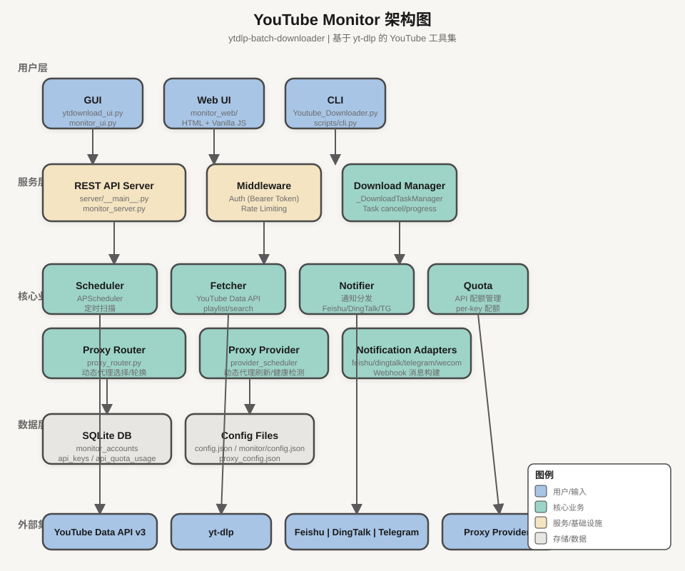

# YouTube 视频批量下载器

一款基于 [yt-dlp](https://github.com/yt-dlp/yt-dlp) 的 YouTube 工具集，包含：

1. **批量下载**：从 Excel / CSV / TXT / SQLite 导入 URL，图形界面或命令行批量下载视频（可选 aria2 多连接加速），支持代理池轮换、Cookie 认证、WhisperX ASR 字幕生成。
2. **频道监控**：多账户、定时扫描频道新视频、SQLite 持久化、YouTube Data API 配额统计与保险分配方案，支持飞书 / 钉钉 / 企业微信通知与 Web 管理界面。
3. **频道视频获取**：输入频道 URL，自动获取频道全部视频链接并存储为 CSV 或 SQLite，支持后台增量补全上传日期。
4. **数据库管理**：SQLite 数据库浏览器，支持标题/日期/频道/播放量筛选、分页、排序、全选/反选、批量下载。

---

## 系统架构



---

## 最近更新（2026-04）

> **配额分配保险建议**：详见 [docs/quota-analysis.md](docs/quota-analysis.md)。默认 API Key 每日 10,000 units，`playlist` 模式（~3 units/次）可支撑 **5 个频道 × 5 分钟间隔**（85% 上限）。

### Monitor Web 界面与信息架构

| 变更 | 说明 |
|------|------|
| **设置中心分栏** | 下载 / API Keys / 通知 / 动态代理 / AI 等分页面模板（`monitor_web/templates/pages/settings-*.html`），入口聚合于设置 Hub |
| **Hash SPA 路由** | `monitor_web/static/js/router.js` 驱动主内容区切换，与侧边栏联动 |
| **国际化** | `monitor_web/static/i18n/zh.json`、`en.json` + `i18n.js`，界面中英文切换 |
| **视觉统一** | CSS 变量与组件样式收敛（`variables.css`、`layout.css`、`modal.css` 等），模态（视频详情、切片历史、批量下载、账户等）对齐同一套交互壳层 |
| **AI 切片配置** | 全局/切片相关开关与质量项可通过配置与 Web 侧读写（与 `config/settings.py`、`clip_tasks` DB 迁移衔接） |

### 架构演进

| 变更 | 说明 |
|------|------|
| **服务拆分** | `monitor_server.py` 转发到 `server/__main__.py`，`server/` 下有中间件（rate_limit、auth） |
| **下载任务管理** | 后台下载任务管理器（`_DownloadTaskManager`），支持任务取消、进度跟踪、结果持久化 |
| **批量上传存储** | `_BatchUploadStore` 管理历史任务，支持重新下载 |

### 批量下载 GUI 新增

| 功能 | 说明 |
|------|------|
| **频道视频获取** | 输入频道 URL → YouTube API → SQLite/CSV，支持限制数量（`前 N 条`）和后台补全上传日期 |
| **数据库浏览器** | 打开 SQLite 文件，筛选（标题/日期/频道/播放量/数据状态/下载状态）、分页、排序、全选/反选、导出 CSV |
| **多格式支持** | Excel (`.xlsx`/`.xls`)、CSV、纯文本 (`.txt`)、SQLite 数据库 |
| **Cookie 文件** | 支持 `.txt`（Netscape 格式）和 `.json`（YouTube 官方导出），自动转换 |
| **代理池** | 从文件加载多个代理，自动轮换，代理失败自动切换下一代理，直连兜底 |
| **WhisperX ASR** | 视频无官方字幕时自动调用 WhisperX 生成字幕（支持 GPU/CPU），VTT 格式自动转 SRT |

### AI 视频切片管线（迭代中完善）

| 组件 | 说明 |
|------|------|
| **`scripts/clip_pipeline.py`** | 多步编排（字幕 → 大纲/时间线 → 评分 → 切片等），支持断点续跑 |
| **`scripts/video_processor.py`** | ffmpeg 切割与合集；长宽比检测与 `scale+pad`；VTT/SRT 软字幕封装为 MKV |
| **`scripts/thumbnail_generator.py`** | 切片封面图（Pillow 排版 / 可选 AI 策略） |
| **数据库** | `clip_tasks` 表含封面路径、字幕路径、长宽比等字段（迁移 v15+）；详见 `docs/planning-with-files/clip-enhancements/task_plan.md` |

### 下载核心增强

| 功能 | 说明 |
|------|------|
| **SOCKS 代理** | 检测 SOCKS 代理 URL，自动禁用 aria2c（不支持）改用 yt-dlp 内置分片 |
| **代理熔断** | 代理可重试错误（429 限流/超时/连接重置/SOCKS 错误）时自动换下一个，全部失败后直连兜底 |
| **Cookie 导出** | JSON Cookie → 临时 Netscape 格式文件，下载后自动清理 |
| **多格式字幕** | 优先下载官方字幕（`.srt`/`.vtt`），无官方字幕时触发 WhisperX ASR |

### API 配额管理

| 功能 | 说明 |
|------|------|
| **配额分析文档** | 详见 `docs/quota-analysis.md`：playlist 模式 3-4 units/次，search 模式 102-103 units/次 |
| **保险分配表** | 5 分钟扫描 ≤ 5 个频道/Key，10 分钟 ≤ 11 个，15 分钟 ≤ 17 个（基于 85% 上限） |
| **per-key 配额** | 每个 API Key 独立设置每日配额上限，支持配额统计日时区配置 |

---

## 目录

- [功能特性](#功能特性)
- [最近更新](#最近更新2026-04)
- [前置依赖](#前置依赖)
- [快速开始](#快速开始)
- [打包 exe 使用指南](docs/exe使用指南.md)
- [YouTube 频道监控](#youtube-频道监控)
- [使用说明（批量下载）](#使用说明批量下载)
- [打包指南](#打包指南保姆手册)
- [消息通知](#消息通知)
- [Claude Code / Agent Skill 集成](#claude-code--agent-skill-集成)
- [文件结构](#文件结构)
- [技术栈](#技术栈)
- [开发与测试](#开发与测试)

---

## 功能特性

### 批量下载

- 支持 Excel (`.xlsx`/`.xls`)、CSV (`.csv`)、纯文本 (`.txt`)、SQLite 数据库四种 URL 文件格式
- 自定义视频分辨率（720p / 1080p / 1440p），默认最高画质
- HTTP 代理与代理池（自动轮换 + 直连兜底）
- 可视化下载进度条（`ytdownload_ui.py`）
- **字幕**：支持官方字幕下载（yt-dlp），无官方字幕时自动触发 WhisperX ASR 生成字幕
- **aria2**：CLI 默认使用 `aria2c` 外部下载器；可用 `--no-aria2` 改为 yt-dlp 内置分片
- **Cookie**：支持 `.txt`（Netscape 格式）和 `.json`（YouTube 官方导出），自动转换

### 频道监控（`monitor/`）

- 多监控账户、可配置扫描间隔与每次获取条数
- **SQLite** 存储账户与视频记录；**APScheduler** 定时扫描
- **YouTube Data API v3** 调用与每日配额统计（`monitor/quota.py`）；推荐 `playlist` 模式（~3 units/次）节省配额
- **通知**：飞书（含 JSON 2.0 卡片 / 模板）、钉钉、企业微信 Webhook
- **Web UI**：`server/__main__.py` + `monitor_web/`，支持账户管理、API Key 管理、通知配置、全局配置（含「启用 aria2」等）、后台下载任务（含取消功能）；设置中心分栏、Hash 路由、中英文界面（`static/i18n/`）
- **代理池**：动态代理提供商（`_provider_scheduler`）定时刷新候选，支持按健康/最快策略自动选择代理用于下载和扫描
- 可选阅读：[扫描后自动下载方案说明](docs/auto-download-on-scan-plan-v2.md)

---

## 前置依赖

### 必须安装

| 依赖 | 说明 |
|------|------|
| **Python 3.9+** | 运行环境 |
| **ffmpeg** | 合并与编码；见 [FFmpeg 安装指南](docs/ffmpeg安装指南.md) |
| **yt-dlp** | 下载引擎 |

安装 Python 依赖（版本以仓库内 `requirements.txt` 为准）。**使用打包 exe 时仅需安装 ffmpeg，无需 Python 环境**，详见 [打包 exe 使用指南](docs/exe使用指南.md)：

```bash
pip install -r requirements.txt
```

当前 `requirements.txt` 主要包含：`yt-dlp`、`pandas`、`tqdm`、`google-api-python-client`、`APScheduler`、`requests`、`openpyxl`、`tenacity` 等（监控与批量下载共用）。

### 可选

| 依赖 | 说明 |
|------|------|
| **aria2c** | 多连接加速；未安装时 CLI 可用 `--no-aria2` |
| **whisperx** | 无官方字幕时的 ASR：`pip install whisperx`（体积较大，按需安装） |

### WhisperX 模型

默认 CLI 使用 `medium` 模型；首次使用会下载到 `~/.cache/huggingface/hub/`。

### aria2 安装（Windows）

本项目 `Youtube_Downloader.py` 默认通过 **aria2c** 作为外部下载器；请确保可在终端执行 `aria2c`（已加入 `PATH`）。

**方式一：winget（推荐）**

```powershell
winget install --id aria2.aria2 --source winget --accept-package-agreements --accept-source-agreements
```

新开终端后执行 `aria2c --version` 验证。

**方式二**：从 [aria2 Releases](https://github.com/aria2/aria2/releases) 下载，将含 `aria2c.exe` 的目录加入系统 `Path`。

**不使用 aria2 时**：`python Youtube_Downloader.py ... --no-aria2`，并可用 `--concurrent-fragments N` 调节内置分片并发。

#### aria2 与内置分片对比（CLI）

速度因网络、代理、YouTube 限流而异，建议同一 URL、同一网络做对照：一次默认 aria2，一次 `--no-aria2 --concurrent-fragments 16`（可按机器调低）。输出目录分开，避免断点续传干扰对比。

监控 Web UI：**全局配置** 中可开启「aria2 多连接加速」；开启后，调度器自动下载、接口触发的下载等路径会与 `Youtube_Downloader.build_aria2_opts()` 对齐（见 `monitor/config.json` 中 `enable_aria2`）。

---

## 快速开始

### 方式一：批量下载图形界面

```bash
pip install -r requirements.txt
python ytdownload_ui.py
```

主窗口内可打开 **监控 Web UI**（本地 HTTP，详见下文）。GUI 功能包括：

- **获取频道视频**：输入频道 URL → YouTube API → SQLite/CSV，支持补全上传日期
- **数据库浏览器**：打开 SQLite 文件，筛选/排序/分页/全选，批量下载所选视频
- **批量下载**：Excel/CSV/TXT/SQLite 多格式，代理池轮换，WhisperX ASR 字幕

### 方式二：CLI 命令行下载

```bash
# 单链接或列表文件（Excel/TXT）
python Youtube_Downloader.py -i "https://www.youtube.com/watch?v=xxx" -o videos

python Youtube_Downloader.py -i urls.xlsx -o videos -r 1080p -p http://127.0.0.1:7890

# 不下载字幕
python Youtube_Downloader.py -i urls.xlsx --no-subs

# 字幕语言（CLI 默认会尝试下载字幕，以代码与参数为准）
python Youtube_Downloader.py -i urls.xlsx --sub-lang "zh-Hans,en,ja"

# 关闭 aria2，仅内置分片
python Youtube_Downloader.py -i urls.xlsx -o videos --no-aria2 --concurrent-fragments 8
```

### 方式三：打包 exe

详细使用说明见 [打包 exe 使用指南](docs/exe使用指南.md)。打包步骤：

- 批量下载 GUI：使用 `YouTube批量下载器.spec`，生成 `dist/YouTube批量下载器.exe`
- 仅监控服务：使用 `YouTubeMonitor.spec`，生成 `dist/YouTubeMonitor.exe`

> **WebView2 默认**：双击 `YouTubeMonitor.exe` 默认使用 WebView2 内嵌窗口；WebView2 不可用时自动回退 Chrome。使用 `--browser` 可强制 Chrome。

---

## YouTube 频道监控

### 运行方式（任选）

| 方式 | 命令 | 说明 |
|------|------|------|
| **独立 WebView2 GUI** | `python monitor_ui.py` | 默认 WebView2 内嵌窗口；WebView2 不可用时自动回退 Chrome；端口 5000 |
| Web 服务（端口 5000） | `python monitor_server.py` | 浏览器访问控制台；可加 `--port`、`--no-browser` |
| 强制浏览器模式 | `python monitor_ui.py --browser` | 强制使用外部 Chrome，绕过 WebView2 |
| 无界面调度 | `python -m monitor` | 常驻调度；`--once` 单次跑完全部账户 |
| CLI 管理账户 | `python -m monitor --list` / `--add ...` | 详见 `monitor/__main__.py` 帮助 |

> **WebView2**：Windows 10/11 内置，无需安装。双击 exe 默认使用 WebView2，无需额外操作。

### 配置与数据

- 全局配置：`monitor/config.json`（飞书/钉钉/企业微信 Webhook、默认扫描参数、下载目录与 cookies 路径、`enable_aria2` 等）。**勿将含真实密钥的配置提交到公开仓库**；本地可复制示例后自行填写。
- 数据库：由 `monitor/db.py` 初始化，默认位于 `data/monitor.db`。**包含敏感信息（YouTube API Keys 等），勿将其提交到版本控制或公开仓库**。`data/` 目录已在 `.gitignore` 中排除。
- **YouTube Data API**：API Key 存储于 SQLite 数据库（`api_keys` 表），通过 Web UI「🔑 API Keys」按钮管理。自动迁移：若存在 `YOUTUBE_Data_API_V3` 等环境变量，首次启动时自动导入为数据库 Key（优先级：账户指定 → 系统默认 → 环境变量）。

  **API Key 管理功能**：
  - 多 Key 存储：支持添加多个 YouTube Data API v3 Key，每个可独立设置每日配额上限
  - 配额追踪：per-key 按 **日历日** 累计 **配额单位（Quota units）**，与 HTTP 调用次数不同（例如 `search.list` 约消耗 100 units/次，`playlistItems.list` 多为 1 unit）。可在「全局配置」中切换 **配额统计时区**（`local` 或 `America/Los_Angeles`），便于与 Google Cloud 控制台对照
  - 三层兜底：账户指定 Key → 系统默认 Key → 环境变量 `YOUTUBE_Data_API_V3`
  - Key 值只读：创建后不可修改 Key 值（防止配额数据孤岛），如需更换请删除后重新创建
  - 掩码显示：前端显示 `AIza••••••••xxxx` 格式，完整 Key 值仅存于数据库

> **安全注意**：`data/monitor.db` 包含明文 API Key。备份文件（`data/backup/`）会自动排除 `api_keys` 表，但物理文件访问仍可读取 Key。请妥善保管数据库文件，避免意外泄露。
- **REST API 认证**：除 `/api/status` 外，所有 `/api/*` 端点均需携带 `Authorization: Bearer <token>` 请求头。Token 在首次启动时自动生成并存储于 `app_state` 表；可通过环境变量 `MONITOR_API_TOKEN` 自定义（**环境变量优先于数据库**，设置后立即生效）。前端 Web UI 会自动从 `/api/token` 获取并存储到 `sessionStorage`。

### 安全机制

| 机制 | 说明 |
|------|------|
| **Bearer Token** | 所有 API 端点（除 `/api/status`）需认证；`MONITOR_API_TOKEN` 环境变量优先于数据库 Token，设置后立即生效 |
| **API Key 掩码** | REST API 返回 `AIza••••••••xxxx` 格式，完整 Key 仅存于 DB |
| **速率限制** | 每 IP 每分钟 60 次请求，超限返回 429 + `Retry-After`（`server/middleware/rate_limit.py`） |
| **CORS 白名单** | 仅允许 `localhost`/`127.0.0.1`/`[::1]` origin |
| **Webhook 加密** | Fernet 对称加密存储，`enc:` 前缀标识已加密值 |
| **路径遍历防护** | `os.path.realpath` 解析符号链接，防止目录穿越 |
| **输入验证** | `channel_url` 正则校验，LIKE 通配符转义 |
| **Webhook 告警内容** | 扫描失败、配额、元数据不一致等通知可能含频道 URL、错误摘要或 ID；Webhook 若经第三方转发或公网可解析地址，请自行评估暴露面 |

### REST API 端点

所有端点（除 `/api/status`）均需 `Authorization: Bearer <token>` header。

| 方法 | 路径 | 说明 |
|------|------|------|
| GET | `/api/status` | 健康检查（无需认证） |
| GET | `/api/accounts` | 列出所有监控账户 |
| POST | `/api/accounts` | 新增/编辑账户 |
| DELETE | `/api/accounts/{id}` | 删除账户 |
| POST | `/api/accounts/scan` | 手动触发扫描 |
| GET | `/api/accounts/{id}/videos` | 分页查询视频（含搜索/排序） |
| GET | `/api/api-keys` | 列出所有 API Key（key_value 已掩码） |
| POST | `/api/api-keys` | 新增 API Key |
| POST | `/api/api-keys/{id}` | 更新 API Key |
| DELETE | `/api/api-keys/{id}` | 删除 API Key |
| GET | `/api/api-keys/{id}` | 获取单个 Key 详情 |
| GET | `/api/token` | 获取当前 Bearer token |
| GET | `/api/config` | 获取全局配置 |
| POST | `/api/config` | 保存全局配置 |
| GET | `/api/quota` | 今日 API 配额使用情况 |
| GET | `/api/events` | 最近扫描事件 |
| GET | `/api/stats` | 账户统计 |
| POST | `/api/scheduler/start` | 启动调度器 |
| POST | `/api/scheduler/stop` | 停止调度器 |
| GET | `/api/download-tasks/{id}` | 下载任务进度 |
| POST | `/api/download-tasks/{id}/cancel` | 取消下载任务 |
| GET | `/api/batch-uploads` | 历史批量下载任务 |
| GET | `/api/batch-uploads/{id}` | 历史任务详情（含结果） |
| POST | `/api/batch-uploads/{id}/re-download` | 重新下载历史任务 |
| GET | `/api/proxy-providers` | 动态代理提供商列表 |
| POST | `/api/proxy-providers` | 新增代理提供商 |
| PUT | `/api/proxy-providers/{id}` | 更新代理提供商 |
| DELETE | `/api/proxy-providers/{id}` | 删除代理提供商 |
| POST | `/api/proxy-providers/{id}/refresh` | 手动刷新代理候选 |

调用示例：
```bash
# 获取当前 token
curl http://127.0.0.1:5000/api/token

# 列出 API Keys（需认证）
curl -H "Authorization: Bearer <token>" http://127.0.0.1:5000/api/api-keys
```

### 与批量下载的关系

监控模块复用 `Youtube_Downloader.batch_download` 与 `build_aria2_opts()`，保证 CLI、监控后台、Web 触发的下载行为一致。Web UI 的批量下载通过 `_DownloadTaskManager` 管理后台任务，支持取消。

---

## 使用说明（批量下载）

### 1. 获取频道视频（可选）

GUI 主窗口输入频道 URL（如 `@频道名` 或完整频道链接），设置「前 N 条」，点击「获取视频」。数据以 SQLite 格式存储时可后台自动补全上传日期。

### 2. 准备 URL 文件

**Excel**：需包含名为 `url` 的列。  
**CSV**：需包含名为 `url` 的列。  
**TXT**：每行一条链接。  
**SQLite**：由频道获取功能生成，支持在 GUI 中打开、筛选、选择后下载。

详见 [视频链接使用说明](docs/视频链接使用说明.md)。

### 3. 在 GUI 中操作

选择格式与文件、保存路径、分辨率（默认最高画质），必要时填写代理并保存，点击「开始下载」。

---

## 打包指南（保姆手册）

### 前置条件

```bash
python --version
pip --version
```

### 创建虚拟环境与安装依赖

```bash
cd ytdlp-batch-downloader
python -m venv venv_build
venv_build\Scripts\activate   # Windows
pip install -r requirements.txt
pip install pyinstaller
```

### 打包批量下载 GUI（示例）

```bash
python -m PyInstaller --onefile --noconsole --name "YouTube批量下载器" --add-data "docs;docs" --clean ytdownload_ui.py
```

输出一般在 `dist/YouTube批量下载器.exe`。目标机器仍需安装 **ffmpeg**。

### 打包监控程序

使用根目录 `YouTubeMonitor.spec`：

```bash
pyinstaller YouTubeMonitor.spec
```

具体 `datas`、`hiddenimports` 以 spec 文件为准。

### 常见问题

- **缺少 dll**：安装 Visual C++ Redistributable。
- **exe 过大**：勿用装满 torch/sklearn 的全局环境打包，应用干净虚拟环境。
- **`docs` 未打进包**：Windows 下 `--add-data "docs;docs"` 使用分号。

---

## 消息通知

### 飞书

- 机器人 Webhook（开放平台）：在飞书群中添加自定义机器人，复制 Webhook 地址填入 `monitor/config.json` 或账户级配置。
- 官方文档：[自定义机器人使用指南](https://open.feishu.cn/document/client-docs/bot-v3/add-custom-bot)（以飞书当前文档为准）。

发送方式支持 **Markdown 卡片（JSON 2.0）** 与 **模板卡片**；桌面端 `monitor_ui` 账户对话框中可选择模式并保存模板 ID。

---

## 文件结构

```
ytdlp-batch-downloader/
├── ytdownload_ui.py           # 批量下载 GUI（含频道获取、数据库浏览器）
├── Youtube_Downloader.py       # 下载核心（batch_download、代理池、WhisperX、aria2）
├── ytb_api.py                 # YouTube Data API 辅助（监控等使用）
├── yt_channel_fetch.py        # 频道视频批量获取（CSV/SQLite 导出）
├── requirements.txt
├── proxy_config.json          # 代理配置（运行时可生成）
├── scripts/
│   ├── cli.py               # 统一 CLI 入口（Skill 调用此脚本）
│   └── whisperx_worker.py   # WhisperX ASR 子进程工作器
├── monitor/                   # 频道监控包
│   ├── __main__.py           # python -m monitor CLI
│   ├── db.py / scheduler.py / notifier.py / quota.py / detector.py / cache.py
│   ├── proxy_selector.py / proxy_validator.py / proxy_candidate_pool.py
│   ├── dynamic_provider_resolver.py  # 动态代理解析
│   ├── provider_scheduler.py / provider_health.py / provider_templates.py
│   ├── config.json            # 全局监控配置（本地敏感信息勿泄露）
│   └── schema.sql
├── server/                    # Web 服务（`monitor_server.py` 转发至此）
│   ├── __main__.py           # HTTP API 入口（`server/__main__.py`）
│   └── middleware/
│       ├── rate_limit.py     # 速率限制中间件
│       └── auth.py           # Bearer Token 认证中间件
├── monitor_server.py          # 兼容入口（转发到 server/__main__.py）
├── monitor_web/               # 监控前端（SPA Hash 路由、分模块 JS、分目录模板）
│   ├── static/css/            # 主题与布局（variables / layout / modal / …）
│   ├── static/js/router.js, i18n.js, sidebar.js
│   ├── static/i18n/zh.json, en.json
│   └── templates/pages/      # settings-hub, settings-download, settings-api, …
├── monitor_ui.py              # 监控 WebView2/浏览器双模式启动器
├── .claude/skills/            # Claude Code Skill 定义
│   ├── yt-dlp-batch-download/SKILL.md
│   └── youtube-channel-monitor/SKILL.md
├── mcp-server/                # OpenClaw MCP Server
│   ├── server.py
│   └── openclaw-config.json
├── tests/                     # pytest 用例
├── docs/                      # 使用说明与方案文档
│   └── quota-analysis.md     # YouTube Data API 配额分析
├── schema.sql                 # 根目录 SQL（若与 monitor 并存以实际为准）
└── dist/                      # 打包输出（本地生成）
```

---

## 技术栈

| 领域 | 技术 |
|------|------|
| 批量 GUI | tkinter |
| 下载 | yt-dlp、可选 aria2c、ffmpeg |
| 监控 GUI | pywebview + WebView2（Windows 内置，无依赖）；不可用时回退 Chrome |
| 监控服务 | 标准库 `http.server`（ThreadingHTTPServer）、SQLite、APScheduler |
| API | Google YouTube Data API v3（`google-api-python-client`） |
| 通知 | requests → 飞书 / 钉钉 / 企业微信 Webhook |
| 表格 | pandas、openpyxl |
| 字幕 ASR（可选） | WhisperX（GPU/CPU） |
| 代理 | 动态代理提供商、自动探活、评分排序 |
| 安全 | Bearer Token 认证、速率限制、Fernet 加密 |

---

## 开发与测试

```bash
pip install -r requirements.txt
# 按需: pip install pytest
python -m pytest tests/ -q
```

部分测试依赖环境变量或网络/API，失败时请查看具体用例说明。当前 `pytest` 收集量级在 **400+** 条用例（以本地 `python -m pytest --collect-only` 为准）。

---

## Claude Code / Agent Skill 集成

本项目提供两个 Claude Code Skill，支持在 Claude Code、Codex、OpenClaw 等 Agent 平台中直接调用。

### 目录结构（新增）

```
ytdlp-batch-downloader/
├── scripts/
│   └── cli.py              # 统一 CLI 入口（Skill 调用此脚本）
├── .claude/skills/
│   ├── yt-dlp-batch-download/SKILL.md       # 批量下载 Skill
│   └── youtube-channel-monitor/SKILL.md     # 频道监控 Skill
└── mcp-server/
    ├── server.py            # OpenClaw MCP Server（零依赖 stdio）
    └── openclaw-config.json # OpenClaw MCP 配置示例
```

### Skill 触发词

| Skill | 触发方式 |
|-------|--------|
| `@yt-dlp-batch-download` | 批量下载相关任务 |
| `@youtube-channel-monitor` | 频道监控相关任务 |

### 安装步骤

#### 1. 克隆项目

```bash
git clone https://github.com/antflyliu/ytdlp-batch-downloader.git
cd ytdlp-batch-downloader
```

#### 2. 创建软链接

Skill 文件位于项目内 `.claude/skills/` 目录，需创建软链接到 Claude Code 的 skill 目录：

**Windows：**

```powershell
# 管理员权限打开 PowerShell
mklink /D "$env:USERPROFILE%\.claude\skills\yt-dlp-batch-download" "%CD%\.claude\skills\yt-dlp-batch-download"
mklink /D "$env:USERPROFILE%\.claude\skills\youtube-channel-monitor" "%CD%\.claude\skills\youtube-channel-monitor"


mklink /J "C:\Users\Administrator\.claude\skills\youtube-channel-monitor" ".claude\skills\youtube-channel-monitor"


```

**macOS / Linux：**

```bash
ln -s "$(pwd)/.claude/skills/yt-dlp-batch-download" ~/.claude/skills/
ln -s "$(pwd)/.claude/skills/youtube-channel-monitor" ~/.claude/skills/
```

#### 3. 重启 Claude Code

Claude Code 启动时自动扫描 `~/.claude/skills/` 下的所有 `SKILL.md` 并注册。重启后即可使用触发词。

#### 4. 启动

```
# PowerShell
> $env:MONITOR_API_TOKEN="123456"
> python monitor_server.py --force-restart
> cd dist
> YouTubeMonitor.exe --force-restart
> YouTubeMonitor.exe --browser
```


### 验证

在 Claude Code 中输入：

```
@ytdlp-batch-download  批量下载几个 YouTube 视频
@youtube-channel-monitor 查看当前监控账户状态
```

### CLI 子命令一览

Skill 内部调用 `scripts/cli.py`，所有子命令支持 `--json` 输出供 AI 解析：

| 子命令 | 说明 |
|--------|------|
| `deps` | 检查 yt-dlp / aria2c / ffmpeg 依赖 |
| `check-url <URL>` | 检测 URL 可下载性 |
| `download -i <input> -o <dir>` | 批量下载视频 |
| `monitor start/stop/once/list` | 启动/停止/单次/列出监控 |
| `stats` | 监控账户统计 |
| `events --limit N` | 最近扫描事件 |
| `list` | 账户列表 |
| `quota [--api-key ENV]` | API Quota 查询 |

### OpenClaw MCP Server（可选）

如需在 OpenClaw 中使用，将 `mcp-server/openclaw-config.json` 内容合并到 OpenClaw 配置文件中：

```json
{
  "mcpServers": {
    "ytdlp-downloader": {
      "command": "python",
      "args": ["mcp-server/server.py"],
      "cwd": "<项目根目录>",
      "transportType": "stdio"
    }
  }
}
```

---

## Roadmap

> 以下为能力演进：部分已落地于 `scripts/` 与监控库，其余仍以规划/验证为主。

### Stage 1：AI 视频切片核心（AI Video Clipper）

目标：将长视频自动切段为可发布的高光片段；设计参考 [autoclip](https://github.com/zhouxiaoka/autoclip) 等多步 AI Pipeline。

```
视频下载 → WhisperX 字幕 → 大纲提取 → 时间线提取 → 精彩评分 → 标题生成 → 智能合集 → 视频切片
```

**已在仓库中的落地（持续迭代）**：
- `scripts/video_clipper.py` — Pipeline 侧 CLI 入口（与编排脚本配合使用）
- `scripts/clip_pipeline.py` — 多步编排器（可断点续跑）
- `scripts/video_processor.py` — ffmpeg 切割、合集、长宽比、软字幕 MKV
- `scripts/thumbnail_generator.py` — 切片封面图
- `scripts/llm_client.py`、`scripts/text_processor.py`、`scripts/prompts/` — 与 Pipeline 配套
- `clip_tasks` 表与迁移、配置项 — 见 `docs/planning-with-files/clip-enhancements/task_plan.md`

**后续**：CLI 入口统一命名、与监控 UI 的更紧耦合、端到端 FFmpeg 回归与更多模型后端，见 [autoclip 集成规划](docs/planning-with-files/autoclip-integration/task_plan.md)。

---

## 许可证与声明

请遵守 YouTube 服务条款及当地法律法规；本工具仅供个人学习与合法用途。仓库内示例配置、Webhook 占位符请勿直接用于生产而不经审查。
