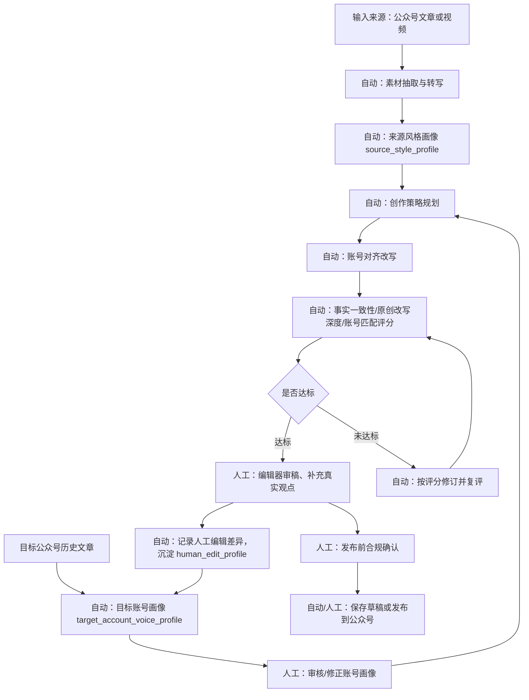

# AI 文章生成目标公众号风格对齐方案（Codex 2026-05-01）

## 1. 结论

当前 AI 创作模块已经会对来源文章或视频转写做风格分析，但还没有对“即将发布到的微信公众号”做目标账号风格分析。

现状链路是单侧画像：

- 来源侧：分析原公众号文章或视频转写的结构、节奏、信息密度、论证方式和表达策略。
- 发布侧：只使用全局静态配置，例如 `article_wechat_prompt_role`、`article_wechat_prompt_reader_persona`、`article_wechat_prompt_style`。
- 质量侧：有 0-10 分自动评估与低分修订，但评分维度还没有“目标账号匹配度”和“原创改写深度”。

推荐改造为双画像链路：

- `source_style_profile`：来源材料画像，用来理解素材结构和表达方法。
- `target_account_voice_profile`：目标公众号画像，用来约束最终文章像该账号会发布的内容。
- `human_edit_profile`：人工编辑痕迹和偏好，用来把模型输出收敛到真实账号长期表达，而不是单纯模型腔。
- `prompt_eval_score`：每次提示词版本和生成结果都落库评分，用于选择最优提示词模板。

边界必须明确：不要把目标定义成“规避腾讯 AI 检测”。更稳妥、可上线的目标是“保留真实作者表达、可追溯素材、可审核人工编辑、符合账号风格、符合平台和监管标识要求”。2025 年 9 月 1 日起施行的《人工智能生成合成内容标识办法》要求规范 AI 生成合成内容标识；公开报道也显示微信公众号在 2026 年 4 月加强了对脱离真实创作者表达、AI 改写拼接、自动化批量发布等行为的治理。系统设计应服务合规和质量，而不是绕过检测。

## 2. 当前代码链路核验

### 2.1 入口

前端入口在 `frontend-vue/src/views/AiCreation.vue`，文章任务支持两类来源：

- `video`
- `wechat_article`

前端提交到 `POST /api/article/generate`，接口定义在 `frontend-vue/src/api/aiContent.ts`。

后端入口在 `server/__main__.py` 的 `_api_article_generate`：

- 当 `source_type=wechat_article` 时，支持 `wechat_artifact_id`、`article_source_path`、`article_text`。
- 如果传入 `article_source_path`，会限制路径必须在公众号采集输出目录下。
- 当 `source_type=video` 时，支持 `monitor_video_id`、`video_id`、`video_url`、`video_title`。

### 2.2 数据处理

核心流程在 `scripts/article_generator.py` 的 `ArticleGenerationPipeline.run()`。

公众号文章来源：

1. 读取 `article_text`。
2. 如果没有直接文本，读取 `article_source_path`。
3. 将文章正文作为 `transcript` 写入 `transcript.txt`。
4. `transcript_source=wechat_article`。

视频来源：

1. 优先读本地字幕。
2. 没有本地字幕时尝试远程字幕。
3. 字幕不可用时下载音频并调用 Whisper。
4. 输出转写文本到 `transcript.txt`。

两类来源进入相同提示词流水线：

1. `optimize`：整理转写或原文。
2. `style_analysis`：分析来源风格。
3. `summary`：生成摘要策略。
4. `translate/rewrite`：二次创作为公众号正文。
5. `quality_review`：JSON 评分。
6. `revision`：低于阈值时修订并复评。
7. `illustration`：可选生成配图。
8. `draft`：写入 `draft.md`。
9. `wechat`：如配置公众号发布能力，保存草稿或发布。

### 2.3 当前已使用的提示词

当前提示词由 `WechatArticlePromptEngine` 生成。

公共约束 `_common_contract()`：

- 角色：`article_wechat_prompt_role`，默认面向公众号编辑。
- 读者画像：`article_wechat_prompt_reader_persona`。
- 风格要求：`article_wechat_prompt_style`。
- 输出格式：Markdown。
- 安全边界：不输出 HTML、`<script>`、`<style>` 或外链脚本。
- 事实边界：不编造事实、数据、来源或人物观点。
- 微信适配：标题、摘要、正文长度约束。

现有提示词清单：

| 阶段 | 方法 | 作用 | 当前不足 |
| --- | --- | --- | --- |
| 素材整理 | `build_optimize_prompt()` | 修正错别字、断句，保留关键信息 | 没有区分目标账号偏好的保留/删减规则 |
| 来源风格分析 | `build_style_analysis_prompt(source_type)` | 分析来源结构、节奏、信息密度、论证方式 | 只分析来源，不分析目标公众号 |
| 摘要策略 | `build_summary_prompt()` | 生成一句话摘要、要点、章节结构、文末互动 | 没有按目标账号栏目/读者习惯规划 |
| 二次创作 | `build_rewrite_prompt(target_lang)` | 基于素材、摘要策略、来源风格画像生成公众号正文 | 风格迁移以来源为主，缺少目标账号风格约束 |
| 翻译整理 | `build_translate_prompt(target_lang)` | 无 LLM 深度改写时整理为目标语言正文 | 不适合目标账号强风格对齐 |
| 质量评估 | `build_evaluation_prompt(target_lang)` | 0-10 分 JSON 评分 | 没有目标账号匹配度、原创深度、人工审核维度 |
| 低分修订 | `build_revision_prompt(target_lang)` | 根据评分意见修订正文 | 没有按目标账号画像修订 |

当前已经会把 `style_profile.txt`、`article_evaluation.json`、`revision.md`、`final_body.md` 等产物写到文章输出目录，并在任务结果 metadata 里保存评分、阈值和是否采用修订稿。

## 3. 目标方案：双画像 + 页面化流程 + 人工审核闭环

### 3.1 总体流程



### 3.2 页面要求

在现有 `AI 创作` 页面扩展，不建议新建完全独立入口。

新增三个可视区域：

1. 任务创建区新增“目标公众号画像”
2. 任务详情区新增“文章生成流程”
3. 任务详情区新增“人工操作区”

页面上必须明确区分：

- 自动执行：系统可以后台完成的步骤。
- 人工审核：必须给人类编辑留操作位置。
- 可选人工增强：人类可以进一步提升质量的步骤。
- 发布前确认：必须由人类确认的合规、事实和账号风格检查。

### 3.3 页面信息结构

#### A. 任务创建区

字段：

| 字段 | 类型 | 说明 |
| --- | --- | --- |
| 来源类型 | 下拉 | 视频 / 公众号文章 |
| 来源材料 | 输入/选择 | 现有视频或公众号文章输入能力 |
| 目标公众号 | 下拉 | 选择要发布到哪个账号 |
| 目标画像版本 | 下拉 | 默认使用最新已审核版本 |
| 创作模式 | 分段控件 | 保守改写 / 深度重构 / 评论型原创 |
| 人工审核要求 | 复选框 | 发布前必须人工编辑、必须事实核验、必须合规确认 |
| 自动发布策略 | 单选 | 只生成草稿 / 保存公众号草稿 / 人工确认后发布 |

#### B. 文章生成流程区

在任务详情页用 stepper/timeline 展示关键步骤：

| 步骤 | 类型 | 页面展示 | 产物 |
| --- | --- | --- | --- |
| 读取来源 | 自动 | 来源类型、读取路径、转写方式 | `transcript.txt` |
| 素材整理 | 自动 | 字数、主要章节、噪声处理结果 | `optimized.txt` |
| 来源风格分析 | 自动 | 结构、节奏、信息密度 | `style_profile.txt` |
| 目标账号画像 | 自动 + 人工 | 画像状态、样本数量、版本 | `target_account_profile.json` |
| 创作策略 | 自动 | 标题方向、章节策略、差异化角度 | `article_strategy.json` |
| 生成正文 | 自动 | 模板版本、模型、温度 | `translated.txt` |
| 自动评分 | 自动 | 总分和分项分数 | `article_evaluation.json` |
| 自动修订 | 自动 | 是否触发、修订原因、复评分 | `revision.md` |
| 人工编辑 | 人工 | 编辑器、diff、保存按钮 | `human_edited.md` |
| 发布前确认 | 人工 | 检查清单、风险提示 | `publish_checklist.json` |
| 草稿/发布 | 自动 + 人工 | 保存草稿、发布按钮、状态轮询 | 公众号草稿或发布任务 |

#### C. 人工操作区

必须预留以下操作：

| 人工操作 | 触发时机 | 页面控件 | 目的 |
| --- | --- | --- | --- |
| 审核目标账号画像 | 画像生成后 | “确认画像 / 编辑画像 / 重新分析” | 防止模型误判账号风格 |
| 修正创作策略 | 正文生成前或生成后 | 策略编辑抽屉 | 加入真实编辑立场、栏目方向 |
| 编辑正文 | 初稿或修订稿生成后 | Markdown 编辑器 + 预览 | 留下真实人工表达 |
| 事实核验 | 发布前 | checklist + 备注 | 防止编造、误引、来源缺失 |
| 原创度确认 | 发布前 | 风险分、差异说明 | 防止简单改写/拼接 |
| AI 标识确认 | 发布前 | 显式标识/辅助创作说明选项 | 满足平台和监管要求 |
| 保存公众号草稿 | 审核通过后 | 按钮 | 进入微信后台最终确认 |
| 发布 | 人工确认后 | 按钮 + 二次确认 | 避免无人值守批量发布 |

## 4. 新增数据模型

### 4.1 目标账号画像表

建议新增 `wechat_account_style_profiles`。

| 字段 | 类型 | 说明 |
| --- | --- | --- |
| `id` | integer | 主键 |
| `account_key` | text | fakeid、biz、appid 或内部账号标识 |
| `account_name` | text | 公众号名称 |
| `profile_version` | integer | 画像版本 |
| `sample_article_ids` | text/json | 样本文章 ID 或路径 |
| `sample_count` | integer | 样本数量 |
| `profile_json` | text/json | 结构化画像 |
| `profile_markdown` | text | 人可读画像 |
| `status` | text | draft / reviewed / archived |
| `reviewer_note` | text | 人工修订说明 |
| `created_at` | text | 创建时间 |
| `updated_at` | text | 更新时间 |

画像 JSON 推荐结构：

```json
{
  "account_name": "目标公众号",
  "positioning": "账号定位",
  "reader_persona": ["主要读者"],
  "topic_boundaries": {
    "preferred": ["常写主题"],
    "avoid": ["不适合主题"]
  },
  "voice": {
    "personality": ["克制", "专业", "有判断"],
    "tone_range": ["分析型", "解释型"],
    "forbidden_tones": ["营销腔", "标题党"]
  },
  "structure_patterns": [
    "开头先给判断，再展开背景",
    "中段用小标题分层",
    "结尾给行动建议或反问"
  ],
  "density": {
    "paragraph_length": "短段落",
    "data_usage": "必要时引用",
    "examples_usage": "偏好真实案例"
  },
  "title_patterns": ["判断型标题", "问题型标题"],
  "interaction_patterns": ["文末提问", "关注下一篇"],
  "must_keep": ["事实来源", "作者判断"],
  "must_avoid": ["照搬来源语句", "空泛价值观"]
}
```

### 4.2 提示词版本表

建议新增 `article_prompt_templates`。

| 字段 | 类型 | 说明 |
| --- | --- | --- |
| `id` | integer | 主键 |
| `template_key` | text | 如 `account_aligned_rewrite` |
| `version` | text | 如 `v1.0.0` |
| `content` | text | 提示词模板 |
| `status` | text | active / candidate / archived |
| `created_at` | text | 创建时间 |

### 4.3 提示词评分表

建议新增 `article_prompt_eval_runs`。

| 字段 | 类型 | 说明 |
| --- | --- | --- |
| `id` | integer | 主键 |
| `task_id` | text | 文章任务 ID |
| `template_key` | text | 提示词类型 |
| `template_version` | text | 版本 |
| `model` | text | 模型 |
| `input_hash` | text | 输入摘要哈希 |
| `output_hash` | text | 输出摘要哈希 |
| `quality_score` | real | 综合质量分 |
| `account_match_score` | real | 目标账号匹配分 |
| `factuality_score` | real | 事实忠实分 |
| `originality_score` | real | 原创重构分 |
| `human_edit_distance` | real | 人工编辑距离 |
| `selected` | integer | 是否被选为最终结果 |
| `rationale` | text | 选择理由 |
| `created_at` | text | 创建时间 |

## 5. 新增提示词模板

提示词结构建议使用 XML 风格分区。OpenAI 提示工程建议明确任务、上下文、格式和约束；Anthropic 文档也建议用语义清晰的 XML tags 分隔复杂提示上下文。这里的模板保持可迁移，不绑定某一家模型。

### 5.1 目标公众号画像分析

模板键：`target_account_analysis`

```text
你是微信公众号内容策略分析师。你的任务不是模仿某个具体作者身份，而是总结目标公众号公开文章中可复用的账号级写作规范。

<task>
基于样本文章，生成目标公众号的账号风格画像。只分析结构、主题边界、读者关系、语气范围、标题策略、段落密度、论证方式和发布习惯。
</task>

<constraints>
- 不复制样本文章句子。
- 不生成新文章。
- 不推断无法从样本支持的个人隐私或作者身份。
- 不把单篇文章的偶然写法当成账号长期风格。
- 输出必须同时包含 JSON 和 Markdown 摘要。
</constraints>

<account>
名称：{{account_name}}
标识：{{account_key}}
</account>

<sample_articles>
{{sample_articles}}
</sample_articles>

<output_schema>
{
  "positioning": "",
  "reader_persona": [],
  "topic_boundaries": {"preferred": [], "avoid": []},
  "voice": {"personality": [], "tone_range": [], "forbidden_tones": []},
  "structure_patterns": [],
  "density": {"paragraph_length": "", "data_usage": "", "examples_usage": ""},
  "title_patterns": [],
  "interaction_patterns": [],
  "must_keep": [],
  "must_avoid": [],
  "confidence": 0.0,
  "sample_limits": ""
}
</output_schema>
```

### 5.2 来源风格分析增强版

模板键：`source_style_analysis_v2`

```text
你是内容结构分析师。请分析来源材料的结构和信息组织方式，用于后续原创重构，不用于照搬表达。

<source_type>{{source_type}}</source_type>
<source_material>
{{source_material}}
</source_material>

<analysis_dimensions>
1. 信息结构：开头、主体、结尾如何组织。
2. 节奏：短句/长句、段落长度、信息推进速度。
3. 信息密度：事实、观点、案例、数据比例。
4. 论证方式：问题驱动、案例驱动、观点驱动、教程驱动。
5. 可复用策略：只列结构策略，不列可复制句子。
6. 风险：可能侵权、过度相似、事实不确定、口播噪声。
</analysis_dimensions>

请输出 Markdown，不要输出改写正文。
```

### 5.3 创作策略规划

模板键：`article_strategy_planning`

```text
你是公众号选题编辑。请基于来源素材、来源风格画像、目标账号画像，制定一份发布前创作策略。

<source_style_profile>
{{source_style_profile}}
</source_style_profile>

<target_account_profile>
{{target_account_profile}}
</target_account_profile>

<source_material>
{{optimized_material}}
</source_material>

<requirements>
- 必须保留来源事实。
- 必须明显区别于来源文章结构和表达。
- 必须符合目标公众号的栏目定位、读者关系和语气边界。
- 给出 3 个标题候选，每个说明适用原因。
- 给出章节结构、每节要点、需要人工补充的位置。
</requirements>

<output_schema>
{
  "recommended_title": "",
  "title_candidates": [],
  "angle": "",
  "outline": [],
  "facts_to_preserve": [],
  "original_contributions_needed": [],
  "human_input_slots": [],
  "risks": []
}
</output_schema>
```

### 5.4 账号对齐改写

模板键：`account_aligned_rewrite`

```text
你是目标公众号的责任编辑。请把来源素材重构为一篇可发布的微信公众号文章。

<non_negotiable_rules>
- 只使用来源素材中存在的事实，不能编造数据、人物观点、机构结论或引用。
- 不能复制来源文章的连续表达，不能简单同义替换。
- 目标是原创重构：重排结构、改变论证路径、加入编辑判断位，但事实必须可追溯。
- 必须符合目标公众号画像，不要模仿来源作者身份。
- 输出 Markdown 正文，不要输出分析过程。
</non_negotiable_rules>

<target_account_profile>
{{target_account_profile}}
</target_account_profile>

<source_style_profile>
{{source_style_profile}}
</source_style_profile>

<article_strategy>
{{article_strategy}}
</article_strategy>

<source_material>
{{optimized_material}}
</source_material>

<human_editor_notes>
{{human_editor_notes}}
</human_editor_notes>
```

### 5.5 事实一致性评估

模板键：`factuality_evaluation`

```text
你是事实核验编辑。请只评估候选稿是否忠实于来源素材。

<source_material>
{{optimized_material}}
</source_material>

<candidate_article>
{{candidate_article}}
</candidate_article>

<scoring>
0-10 分：
- 10：所有事实都能从来源找到依据，无新增事实。
- 7：大体忠实，但有少量概括过度。
- 4：存在明显未证实信息。
- 0：大量编造或与来源相反。
</scoring>

只输出 JSON：
{
  "score": 8.5,
  "unsupported_claims": [],
  "missing_key_facts": [],
  "rationale": "",
  "revision_instructions": ""
}
```

### 5.6 目标账号匹配评估

模板键：`account_match_evaluation`

```text
你是公众号主编。请评估候选稿是否像目标账号会发布的文章。

<target_account_profile>
{{target_account_profile}}
</target_account_profile>

<candidate_article>
{{candidate_article}}
</candidate_article>

<dimensions>
- 账号定位匹配 20%
- 读者关系匹配 15%
- 语气和表达边界 20%
- 标题和开头策略 15%
- 结构与段落密度 15%
- 文末互动方式 5%
- 不像 AI 模板文的真实编辑判断 10%
</dimensions>

只输出 JSON：
{
  "score": 8.0,
  "matched": [],
  "mismatched": [],
  "human_edit_suggestions": [],
  "revision_instructions": ""
}
```

### 5.7 原创重构深度评估

模板键：`originality_delta_evaluation`

```text
你是原创性审稿编辑。请比较来源素材和候选稿，判断候选稿是否完成了足够的原创重构。

<source_material>
{{source_material}}
</source_material>

<candidate_article>
{{candidate_article}}
</candidate_article>

<rules>
- 高分不是“脱离来源”，而是在事实忠实基础上的结构、角度、论证路径和表达重构。
- 低分包括：段落顺序基本一致、同义词替换、句式高度相似、缺少新增编辑判断。
- 不要求输出相似句原文，避免扩大复制风险；只输出问题位置摘要。
</rules>

只输出 JSON：
{
  "score": 8.0,
  "structure_delta": "",
  "argument_delta": "",
  "expression_delta": "",
  "risk_sections": [],
  "revision_instructions": ""
}
```

### 5.8 合规与人工审核提示

模板键：`publish_compliance_review`

```text
你是发布前合规审核助手。请生成一份给人类编辑使用的发布前检查清单。

<candidate_article>
{{candidate_article}}
</candidate_article>

<known_context>
来源类型：{{source_type}}
目标公众号：{{account_name}}
是否使用 AI 辅助：{{ai_assisted}}
</known_context>

<requirements>
- 标出需要人工确认的事实、数字、引用、人物观点。
- 标出可能需要 AI 辅助创作说明或平台标识的内容。
- 标出可能被判断为低创作度、拼接、搬运或无人值守发布的风险。
- 不提供规避检测建议，只提供合规和质量改进建议。
</requirements>

只输出 JSON：
{
  "must_check": [],
  "ai_labeling_note": "",
  "platform_risks": [],
  "human_review_actions": [],
  "publish_recommendation": "hold|draft|publish"
}
```

### 5.9 账号对齐修订

模板键：`account_aligned_revision`

```text
你是目标公众号责任编辑。请根据自动评分和人工意见修订候选稿。

<target_account_profile>
{{target_account_profile}}
</target_account_profile>

<source_material>
{{source_material}}
</source_material>

<candidate_article>
{{candidate_article}}
</candidate_article>

<evaluation_reports>
{{evaluation_reports}}
</evaluation_reports>

<human_editor_notes>
{{human_editor_notes}}
</human_editor_notes>

<rules>
- 必须修复事实忠实、账号匹配、原创重构和微信可读性问题。
- 不能新增来源中没有的事实。
- 优先保留人类编辑已经确认的表达。
- 输出最终 Markdown 正文。
</rules>
```

## 6. 评分与提示词择优机制

当前系统已经有文章质量评分，但还不是“提示词实验系统”。建议改成两层评分：

### 6.1 单次文章评分

每篇文章至少记录：

| 分项 | 权重 | 来源 |
| --- | --- | --- |
| 事实忠实度 | 25% | `factuality_evaluation` |
| 目标账号匹配度 | 20% | `account_match_evaluation` |
| 原创重构深度 | 20% | `originality_delta_evaluation` |
| 读者价值 | 15% | 通用质量评估 |
| 微信发布适配 | 10% | 通用质量评估 |
| 表达清晰度 | 10% | 通用质量评估 |

默认通过阈值：

- 综合分 `>= 8.0`
- 事实忠实度 `>= 8.0`
- 原创重构深度 `>= 7.5`
- 目标账号匹配度 `>= 7.5`

任何硬性项低于阈值，必须进入修订或人工审核。

### 6.2 提示词 A/B 候选

对关键模板保留候选版本：

- `account_aligned_rewrite:v1`
- `account_aligned_rewrite:v2`
- `account_aligned_rewrite:v3`

同一来源素材和同一目标账号画像下，可并行生成 2-3 个候选稿，但默认只在“评测模式”开启时启用，避免成本失控。

选择规则：

```text
final_score =
  factuality_score * 0.25 +
  account_match_score * 0.20 +
  originality_score * 0.20 +
  reader_value_score * 0.15 +
  wechat_fit_score * 0.10 +
  clarity_score * 0.10
```

平分时优先级：

1. 事实忠实度更高。
2. 人工编辑距离更低但不为 0。
3. 目标账号匹配度更高。
4. 成本更低。

`human_edit_distance` 不应追求 0。完全不需要人类编辑的文章，反而可能说明模板化过强或人审缺失。更合理的是记录人类编辑偏好，并把高频人工修正沉淀回账号画像和提示词模板。

### 6.3 离线评测集

建立 `tests/fixtures/article_prompt_eval/`：

- 5 篇公众号文章来源样本。
- 5 个视频转写来源样本。
- 2-3 个目标公众号画像样本。
- 每个样本提供人工期望：事实必须保留项、不能出现项、目标账号风格检查项。

可选接入 `promptfoo` 或自建 Python 评测脚本。OpenAI 官方 eval 文档强调持续评估和随生产案例扩充 eval set，这里应把真实失败案例持续加入评测集，而不是只凭单次主观感受改提示词。

## 7. 后端改造点

### 7.1 `scripts/article_generator.py`

新增：

- `build_target_account_analysis_prompt()`
- `build_article_strategy_prompt()`
- `build_account_aligned_rewrite_prompt()`
- `build_factuality_evaluation_prompt()`
- `build_account_match_evaluation_prompt()`
- `build_originality_delta_evaluation_prompt()`
- `build_publish_compliance_review_prompt()`
- `build_account_aligned_revision_prompt()`

修改：

- `_article_generation_payload()` 增加：
  - `target_account_profile`
  - `article_strategy`
  - `human_editor_notes`
  - `evaluation_reports`
- `quality_record` 增加：
  - `factuality_score`
  - `account_match_score`
  - `originality_score`
  - `prompt_template_versions`
  - `selected_candidate`
- metadata 增加：
  - `target_account_profile_id`
  - `target_account_profile_version`
  - `article_strategy_path`
  - `account_match_score`
  - `originality_delta_score`
  - `factuality_score`
  - `publish_compliance_review_path`
  - `human_review_required`

### 7.2 `server/__main__.py`

`POST /api/article/generate` 增加参数：

```json
{
  "target_account_key": "fakeid_or_appid",
  "target_account_profile_id": 1,
  "creation_mode": "conservative|restructure|commentary",
  "require_human_review": true,
  "auto_publish_policy": "draft_only|wechat_draft|manual_publish"
}
```

新增 API：

| API | 方法 | 作用 |
| --- | --- | --- |
| `/api/article/target-profiles` | GET | 列出目标公众号画像 |
| `/api/article/target-profiles/analyze` | POST | 从历史文章生成画像 |
| `/api/article/target-profiles/{id}` | GET | 查看画像详情 |
| `/api/article/target-profiles/{id}` | POST/PATCH | 人工修订画像 |
| `/api/article/{task_id}/human-edit` | POST | 保存人工编辑稿 |
| `/api/article/{task_id}/publish-review` | POST | 保存发布前确认 |
| `/api/article/{task_id}/prompt-evals` | GET | 查看提示词评分记录 |

### 7.3 `monitor/db.py` / schema

需要新增迁移：

- `wechat_account_style_profiles`
- `article_prompt_templates`
- `article_prompt_eval_runs`
- 如现有 `article_tasks` metadata 不够查询，可增加显式字段：
  - `target_account_profile_id`
  - `human_review_status`
  - `selected_prompt_eval_id`

注意：`monitor/schema.sql` 是新库 bootstrap；已有库必须在 `monitor/db.py` 增加增量迁移。

## 8. 前端改造点

### 8.1 `frontend-vue/src/api/aiContent.ts`

扩展 `ArticleTaskCreatePayload`：

```ts
target_account_key?: string
target_account_profile_id?: number
creation_mode?: 'conservative' | 'restructure' | 'commentary'
require_human_review?: boolean
auto_publish_policy?: 'draft_only' | 'wechat_draft' | 'manual_publish'
```

新增 API client：

- `listTargetAccountProfiles()`
- `analyzeTargetAccountProfile(data)`
- `updateTargetAccountProfile(id, data)`
- `saveHumanEditedArticle(taskId, data)`
- `savePublishReview(taskId, data)`
- `listPromptEvalRuns(taskId)`

### 8.2 `frontend-vue/src/views/AiCreation.vue`

建议拆分组件，降低单文件复杂度：

- `ArticleTaskForm.vue`
- `ArticlePipelineTimeline.vue`
- `TargetAccountProfilePanel.vue`
- `HumanArticleReviewPanel.vue`
- `PromptEvalScorePanel.vue`
- `PublishChecklistPanel.vue`

页面展示：

- 在文章表单里选择目标公众号画像。
- 在任务详情里展示自动步骤 timeline。
- 在 timeline 下方展示人工操作区。
- 在输出文件区旁边展示评分雷达或分项分数。
- 在发布按钮前增加人工确认 checklist。

### 8.3 国际化

需要补充：

- `frontend-vue/src/locales/zh.json`
- `frontend-vue/src/locales/en.json`

中文文案重点：

- “目标公众号画像”
- “人工审核”
- “事实核验”
- “原创重构深度”
- “账号匹配度”
- “AI 辅助创作标识”
- “保存为公众号草稿”
- “发布前确认”

## 9. 人工编辑闭环

只做账号画像还不够。真正让文章稳定贴合目标公众号的是“人类编辑差异”。

建议每次人工编辑后记录：

- 删除了哪些模型常用套话。
- 增加了哪些真实观点或账号固定表达。
- 调整了哪些标题类型。
- 哪些段落被认为“像 AI”。
- 哪些事实需要补来源。

系统自动从 diff 中生成 `human_edit_profile`：

```json
{
  "frequent_deletions": ["空泛总结", "过度转折"],
  "frequent_additions": ["明确判断", "读者行动建议"],
  "title_preferences": ["短判断", "少用冒号"],
  "paragraph_preferences": ["每段 80 字以内", "少用首先其次"],
  "forbidden_phrases": ["值得注意的是", "总的来说"],
  "editor_notes": []
}
```

下一次生成时将其加入 `<human_editor_notes>`。

## 10. 分阶段实施计划

### Phase 1：目标账号画像 MVP

目标：

- 能选择目标公众号。
- 能从历史文章生成账号画像。
- 能人工审核画像。
- 生成正文时注入目标画像。

涉及文件：

- `scripts/article_generator.py`
- `server/__main__.py`
- `monitor/db.py`
- `frontend-vue/src/api/aiContent.ts`
- `frontend-vue/src/views/AiCreation.vue`
- `frontend-vue/src/locales/zh.json`
- `frontend-vue/src/locales/en.json`

验收：

- 没有目标画像时保持现有行为。
- 有目标画像时 prompt payload 包含 `<target_account_profile>`。
- 任务 metadata 记录目标画像版本。
- 前端能显示目标画像名称和版本。

### Phase 2：流程页面和人工操作区

目标：

- 任务详情页展示完整生成流程。
- 人工操作区可编辑画像、编辑正文、保存审核状态。
- 发布按钮前必须完成 checklist。

验收：

- 自动阶段和人工阶段视觉上明确区分。
- 低分任务清楚显示原因和下一步操作。
- 人工编辑稿能保存并作为最终稿。

### Phase 3：多维评分与修订闭环

目标：

- 增加事实忠实、账号匹配、原创重构评分。
- 低于阈值自动修订。
- 修订后复评，仍不达标则强制人工审核。

验收：

- `article_evaluation.json` 包含所有分项。
- metadata 可在页面读取并展示。
- 低分不会静默进入发布。

### Phase 4：提示词版本评测和择优

目标：

- 提示词模板版本化。
- 候选提示词可 A/B 生成和评分。
- 系统自动选择最优候选并记录原因。

验收：

- 同一任务可查看 prompt eval runs。
- 被选模板版本可追溯。
- 新提示词版本可用离线 fixtures 回归。

## 11. 测试计划

后端单元测试：

- `wechat_article` 来源仍可生成。
- `video` 来源仍可生成。
- 没有目标画像时保持兼容。
- 有目标画像时 prompt payload 正确注入。
- 账号画像 JSON 解析失败时有兜底错误。
- 低账号匹配分触发修订。
- 修订后仍低于阈值时 `human_review_required=true`。

API 合同测试：

- `POST /api/article/generate` 接收目标账号字段。
- 目标画像 API 能创建、更新、列表、读取。
- 人工编辑 API 能保存 Markdown。
- 发布前 checklist 未完成时不能自动发布。

前端合同测试：

- 表单展示目标公众号选择。
- 任务详情展示 timeline。
- 人工操作区在 `human_review_required=true` 时出现。
- 发布按钮受 checklist 状态约束。

回归命令建议：

```powershell
python -m pytest tests/test_ai_content_provider_pipeline_contract.py tests/test_wechat_article_last_mile.py tests/test_ai_content_api_contract.py tests/test_ai_article_wechat_source_path.py -q
python -m ruff check scripts\article_generator.py server\__main__.py tests\test_ai_content_provider_pipeline_contract.py tests\test_wechat_article_last_mile.py tests\test_ai_content_api_contract.py
python -m py_compile scripts\article_generator.py server\__main__.py
```

## 12. 外部依据

- [OpenAI Prompt Engineering Best Practices](https://help.openai.com/en/articles/6654000-effective-prompting)：强调清晰指令、上下文、格式和具体约束。
- [OpenAI Evaluation Best Practices](https://developers.openai.com/api/docs/guides/evaluation-best-practices)：强调持续评估、生产案例扩充 eval set、用评测防止模型和提示词变动带来回归。
- [Anthropic XML Tags Prompting](https://docs.anthropic.com/en/docs/build-with-claude/prompt-engineering/use-xml-tags)：建议用语义清晰的 XML tags 组织复杂提示上下文。
- [Mailchimp Voice and Tone](https://styleguide.mailchimp.com/voice-and-tone/)：品牌写作应区分稳定 voice 和随上下文变化的 tone，可作为目标公众号画像设计参考。
- [《人工智能生成合成内容标识办法》](https://www.cac.gov.cn/2025-03/14/c_1743654684782215.htm)：规范 AI 生成合成内容标识，2025 年 9 月 1 日起施行。
- [第一财经/新浪：微信公众号打击非真人自动化创作](https://finance.sina.com.cn/wm/2026-04-09/doc-inhtxqku0731008.shtml)：公开报道显示微信公众号加强对脱离真实创作者表达、AI 改写拼接和自动化批量发布的治理。
- [Promptfoo GitHub](https://github.com/promptfoo/promptfoo)：可作为提示词 A/B 评测、回归和质量对比工具参考。

## 13. 推荐落地原则

1. 不追求“骗过检测”，追求“真实账号表达 + 人工审核 + 可追溯素材 + 合规标识”。
2. 来源风格只能用于理解素材，不应成为最终文章的唯一风格目标。
3. 目标公众号画像必须可人工审核和版本化。
4. 发布前必须留人工操作位，不能让系统无人值守批量发布。
5. 每次提示词输出都应评分、留痕、可回放。
6. 人工编辑 diff 是最有价值的优化数据，应沉淀回账号画像和提示词。
7. 低分文章不能静默进入发布链路。
