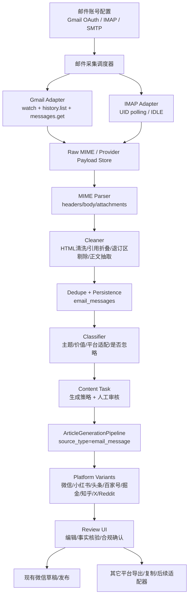

# 邮件监控采集与多平台内容再创作集成方案（codex 2026-05-01）

## 1. 结论

建议把“邮件监控采集”作为新的内容来源域接入现有 AI 文章生产链路，而不是另起一套平行的内容生成系统。

当前项目已经具备三块可复用能力：

- 内容生成：`POST /api/article/generate`、`article_tasks`、`scripts/article_generator.py::ArticleGenerationPipeline`。
- 微信公众号发布：`POST /api/wechat/draft`、`POST /api/wechat/publish`、`wechat_publish_tasks`、`monitor/wechat_publisher.py`。
- 采集任务范式：`wechat_collect_sessions`、`wechat_collect_accounts`、`wechat_collect_articles`、`wechat_collect_tasks` 这类“账号/会话/素材/任务”分层已经在项目里成型。

因此推荐目标架构是：

1. 新增 `monitor/email_collect/` 作为邮件采集、监听、清洗、去重、分类的边界。
2. 新增 `source_type='email_message'` 或更通用的 `content_sources` 关联，让邮件正文进入现有文章生成流水线。
3. 新增平台目标抽象 `content_targets` / `content_variants`，把微信公众号、小红书、今日头条、百度百家号、掘金、知乎、X/Twitter、Reddit 等输出作为“平台文案变体”，而不是把平台逻辑硬编码进一个巨大 prompt。
4. 第一阶段只做“采集、清洗、分类、生成多平台草稿、人工审核、微信公众号草稿/发布桥接”。除微信公众号外，其它平台先产出可复制/导出的发布稿，不默认做无人值守自动发布。

原因很现实：Gmail API、IMAP/SMTP、各内容平台发布 API 的认证、审核、风控和开放程度差异很大。先把“稳定采集 + 可追溯处理 + 平台化文案产物”做好，后续再逐个平台接发布适配器，风险最低。

## 2. 本次外部约束核验

用户提供的 ChatGPT 分享页 `https://chatgpt.com/s/t_69f4574d4fc081918dd41f170f3205ce` 当前只能看到标题“Gmail 邮件采集与监听”和登录/安全提示，正文细节没有暴露。因此本方案不把该分享页作为事实来源，只把它当作需求背景。

关键官方约束如下：

- Gmail API Push Notifications 通过 `users.watch` 监听邮箱变更，底层依赖 Cloud Pub/Sub；`watch` 响应返回当前 `historyId` 和 `expiration`，且需要至少每 7 天续约一次，官方建议每天续约一次。参考：[Configure push notifications in Gmail API](https://developers.google.com/workspace/gmail/api/guides/push)。
- Gmail push 通知只告诉邮箱和新的 `historyId`，真正取变更明细仍要调用 `history.list`。如果长时间没有通知，官方建议周期性 fallback 到 `history.list`。同一用户通知速率上限为每秒 1 个事件，超出可能丢弃。参考：[Configure push notifications in Gmail API](https://developers.google.com/workspace/gmail/api/guides/push)。
- Gmail 同步分全量和增量。首次连接或 `historyId` 不可用时必须全量同步；增量同步用 `history.list(startHistoryId=...)`。历史记录通常至少保留一周，但可能更短；`startHistoryId` 超出可用范围会返回 HTTP 404，此时必须重新全量同步。参考：[Synchronize clients with Gmail](https://developers.google.com/workspace/gmail/api/guides/sync)。
- Gmail `messages.list` 只返回消息 `id` 和 `threadId`，完整正文需要 `messages.get`；`messages.list` 支持 `q`、`labelIds`、`maxResults` 等过滤参数。参考：[List Gmail messages](https://developers.google.com/workspace/gmail/api/guides/list-messages)、[users.messages.list](https://developers.google.com/workspace/gmail/api/reference/rest/v1/users.messages/list)、[users.messages.get](https://developers.google.com/workspace/gmail/api/reference/rest/v1/users.messages/get)。
- Gmail OAuth 应选择最小必要 scope。读取正文的 `gmail.readonly` 属于 restricted scope；公开应用如果存储或传输 restricted scope 数据，可能需要安全评估。参考：[Choose Gmail API scopes](https://developers.google.com/workspace/gmail/api/auth/scopes)。
- Python 标准库可覆盖通用 IMAP/SMTP/MIME 基础能力：`imaplib.IMAP4_SSL` 默认 IMAP-over-SSL 端口为 993；Python 3.14 的 `imaplib.IMAP4.idle()` 支持 IMAP IDLE；`smtplib.SMTP_SSL` 用于从连接开始就 SSL 的 SMTP，`SMTP.starttls()` 用于 STARTTLS；`email.parser` 支持解析 MIME 邮件并访问 `get_body()`、`iter_parts()`、`walk()`。参考：[imaplib](https://docs.python.org/3/library/imaplib.html)、[smtplib](https://docs.python.org/3/library/smtplib.html)、[email.parser](https://docs.python.org/3/library/email.parser.html)。

## 3. 当前项目集成面

### 3.1 后端形态

项目后端不是 FastAPI，而是基于 `SimpleHTTPRequestHandler` 的自定义 HTTP 服务，主要入口在 `server/__main__.py`。

新增邮件 API 不应假设存在框架路由系统。短期可沿用 `server/__main__.py` 的 `do_GET` / `do_POST` 分发模式；中期建议像微信采集一样把业务逻辑下沉到 `monitor/email_collect/` 和 `monitor/db/queries/email_collect.py`，只让 `server/__main__.py` 保持薄 API 层。

### 3.2 AI 文章任务

现有表 `article_tasks` 位于 `monitor/schema.sql`，关键字段包括：

- `source_type`
- `monitor_video_id`
- `video_id`
- `video_url`
- `video_title`
- `article_source_path`
- `article_text`
- `source_url`
- `source_title`
- `draft_path`
- `transcript_path`
- `optimized_path`
- `summary_path`
- `translated_path`
- `stage_json`
- `stages_json`
- `result_json`

这说明文章任务已经从“纯视频任务”扩展到了“通用文本来源 + 视频来源”的中间态。邮件最小接入方式是新增 `source_type='email_message'`，并把清洗后的邮件正文写入 `article_text`，把邮件标题写入 `source_title`，把 Gmail permalink 或内部查看地址写入 `source_url`。

更生产化的方式是：保留 `article_tasks` 的兼容字段，同时新增 `email_message_id` 或通用 `source_ref_type/source_ref_id`，避免后续平台来源越来越多时继续塞字段。

### 3.3 现有文章生成流水线

`scripts/article_generator.py::ArticleGenerationPipeline.run()` 当前逻辑：

- `source_type='wechat_article'`：读取 `article_text` 或 `article_source_path`，作为 `transcript` 进入后续流程。
- 其它来源按视频处理：本地字幕、远程字幕、Whisper 转写。
- 后续统一经过 `optimize`、`style_analysis`、`summary`、`translate/rewrite`、`quality_review`、`revision`、`illustration`、`publish_optimize`、`draft`。
- `scripts/article_publish_optimizer.py` 会生成微信公众号发布稿 `wechat_publish.md`。

邮件接入时不要把 Gmail/IMAP 逻辑写进 `ArticleGenerationPipeline`。正确边界是：

- 邮件采集域负责把原始邮件变成“可消费的清洗文本 + 结构化元数据”。
- 文章流水线只新增一个很薄的 `email_message` 来源读取分支，或从 `article_text` 直接消费。
- 平台化文案输出应作为 `publish_optimize` 的后续扩展，而不是污染字幕/转写阶段。

### 3.4 微信公众号发布能力

现有 `wechat_publish_tasks` 和 `/api/wechat/draft`、`/api/wechat/publish` 已经可以承接 AI 文章结果。邮件内容第一阶段可以直接复用：

1. 邮件采集为 `email_messages`。
2. 人工选择一封邮件或一组邮件。
3. 创建 `article_tasks(source_type='email_message')`。
4. AI 生成微信公众号正文和 `wechat_publish.md`。
5. 调用已有 `POST /api/wechat/draft` 或 `POST /api/wechat/publish`。

不建议第一阶段就给所有平台做自动发布，因为小红书、知乎、掘金、Reddit、X 的开放 API、账号风控和内容审核模式差异大，先输出可审核变体更稳。

### 3.5 配置与加密模式

`config/settings.py` 已有 `_SECRET_CONFIG_KEYS`，并对 `llm_api_key`、`whisper_api_key`、`wechat_app_secret`、`wechat_exporter_auth_key` 等进行加密落盘和运行时解密。

邮件集成必须沿用同一原则：

- Gmail OAuth client secret、refresh token、IMAP password、SMTP password 都必须加密落盘。
- API 返回给前端时只能返回 `***` 或 `has_secret=true`，不能返回原始 secret。
- 前端保存配置时，未修改的 `***` 占位值不得回写覆盖真实密钥。

这个项目近期已经多次修复过 masked secret 回写问题，邮件设置页要从一开始按“占位展示 + 未修改则不提交 secret 字段”的契约设计。

## 4. 推荐总体架构



核心原则：

- 采集层只解决“稳定拿到邮件”和“准确还原可读正文”。
- 处理层解决“清洗、归一化、去重、分类、生成任务”。
- 创作层复用现有 AI 文章流水线，但把平台目标变成可配置目标。
- 发布层先复用微信公众号，其他平台以“人工审核后导出”为第一阶段交付。

## 5. 功能边界

### 5.1 本轮优先支持

| 能力 | Gmail | 通用 IMAP/SMTP |
| --- | --- | --- |
| 账号配置 | OAuth2 client + user consent | host/port/security/auth |
| 收件采集 | Gmail API `messages.list/get` | IMAP UID SEARCH/FETCH |
| 监听/增量 | Push + Pub/Sub + history.list，或退化为轮询 | UID 增量轮询；Python 3.14 可选 IDLE |
| 正文解析 | Gmail `payload` 或 `raw` -> MIME 解析 | 原始 RFC 822 bytes -> MIME 解析 |
| 附件记录 | 可记录元数据，默认不进入创作 | 可记录元数据，默认不进入创作 |
| 发送能力 | 不建议第一阶段使用 Gmail send | SMTP 仅用于连接测试/后续通知，不用于平台发布 |
| 安全策略 | OAuth refresh token 加密，最小 scope | 密码/app password 加密，TLS 必选 |

### 5.2 第一阶段不做

- 不做无审核的全平台自动发布。
- 不把用户邮箱作为群发系统使用。
- 不默认下载大附件、压缩包或可执行附件。
- 不用 LLM 直接处理原始 HTML/MIME；必须先清洗成可追溯文本。
- 不绕过各平台 AIGC 标识、转载授权、原创声明和社区规则。

## 6. 数据模型设计

### 6.1 `email_accounts`

存储邮件账号与连接配置。

| 字段 | 类型 | 说明 |
| --- | --- | --- |
| `id` | INTEGER PK | 内部账号 ID |
| `provider` | TEXT | `gmail` / `imap` |
| `display_name` | TEXT | 前端展示名 |
| `email_address` | TEXT | 邮箱地址 |
| `status` | TEXT | `active` / `paused` / `auth_error` / `disabled` |
| `gmail_client_id_enc` | TEXT | Gmail OAuth client id，可选加密 |
| `gmail_client_secret_enc` | TEXT | Gmail OAuth client secret，加密 |
| `gmail_refresh_token_enc` | TEXT | Gmail refresh token，加密 |
| `gmail_scope_json` | TEXT | 实际授权 scope |
| `imap_host` | TEXT | IMAP host |
| `imap_port` | INTEGER | 默认 993 |
| `imap_security` | TEXT | `ssl` / `starttls` / `none`，生产默认只允许 `ssl/starttls` |
| `imap_username` | TEXT | 登录用户 |
| `imap_password_enc` | TEXT | IMAP 密码或 app password |
| `smtp_host` | TEXT | SMTP host |
| `smtp_port` | INTEGER | 465/587 |
| `smtp_security` | TEXT | `ssl` / `starttls` |
| `smtp_username` | TEXT | SMTP 用户 |
| `smtp_password_enc` | TEXT | SMTP 密码或 app password |
| `sync_mode` | TEXT | `poll` / `gmail_push` / `imap_idle` |
| `poll_interval_seconds` | INTEGER | 默认 300 |
| `include_spam_trash` | INTEGER | 默认 0 |
| `created_at` | TEXT | ISO8601 |
| `updated_at` | TEXT | ISO8601 |

### 6.2 `email_mailboxes`

一个账号可配置多个标签/文件夹。

| 字段 | 类型 | 说明 |
| --- | --- | --- |
| `id` | INTEGER PK | 内部 mailbox ID |
| `account_id` | INTEGER FK | `email_accounts.id` |
| `provider_mailbox_id` | TEXT | Gmail label id 或 IMAP folder |
| `display_name` | TEXT | 展示名 |
| `enabled` | INTEGER | 是否采集 |
| `query` | TEXT | Gmail `q` 或 IMAP 搜索条件 |
| `last_seen_uid` | TEXT | IMAP UID checkpoint |
| `created_at` | TEXT | ISO8601 |
| `updated_at` | TEXT | ISO8601 |

### 6.3 `email_watch_state`

存储增量同步状态。

| 字段 | 类型 | 说明 |
| --- | --- | --- |
| `account_id` | INTEGER PK/FK | 邮件账号 |
| `gmail_history_id` | TEXT | 上次成功处理的 historyId |
| `gmail_watch_expiration` | TEXT | watch 过期时间 |
| `pubsub_topic` | TEXT | Gmail watch topic |
| `pubsub_subscription` | TEXT | 订阅名 |
| `last_full_sync_at` | TEXT | 上次全量同步 |
| `last_incremental_sync_at` | TEXT | 上次增量同步 |
| `last_error` | TEXT | 最近错误 |
| `updated_at` | TEXT | ISO8601 |

### 6.4 `email_messages`

归一化后的邮件素材主表。

| 字段 | 类型 | 说明 |
| --- | --- | --- |
| `id` | INTEGER PK | 内部消息 ID |
| `account_id` | INTEGER FK | 邮件账号 |
| `mailbox_id` | INTEGER FK | 邮箱/标签 |
| `provider` | TEXT | `gmail` / `imap` |
| `provider_message_id` | TEXT | Gmail message id 或 IMAP UID |
| `provider_thread_id` | TEXT | Gmail thread id 或 Message-ID thread |
| `rfc_message_id` | TEXT | `Message-ID` 头 |
| `subject` | TEXT | 标题 |
| `from_addr` | TEXT | 发件人 |
| `to_addr` | TEXT | 收件人 |
| `cc_addr` | TEXT | 抄送 |
| `received_at` | TEXT | 收信时间 |
| `sent_at` | TEXT | 发信时间 |
| `snippet` | TEXT | 摘要 |
| `body_text` | TEXT | 清洗后的正文 |
| `body_markdown_path` | TEXT | 长正文 markdown 文件 |
| `raw_mime_path` | TEXT | 原始 MIME 文件路径，可配置保留 |
| `html_body_path` | TEXT | 原始/清洗 HTML 路径 |
| `body_hash` | TEXT | 去重 hash |
| `dedupe_key` | TEXT | `account_id + provider_message_id` 或 `rfc_message_id + body_hash` |
| `classification_json` | TEXT | 分类结果 |
| `processing_status` | TEXT | `new` / `cleaned` / `classified` / `ignored` / `generated` / `failed` |
| `error` | TEXT | 错误 |
| `created_at` | TEXT | ISO8601 |
| `updated_at` | TEXT | ISO8601 |

索引建议：

- `UNIQUE(account_id, provider, provider_message_id)`
- `UNIQUE(account_id, dedupe_key)`
- `idx_email_messages_received_at(received_at DESC)`
- `idx_email_messages_status(processing_status, received_at DESC)`
- `idx_email_messages_body_hash(body_hash)`

### 6.5 `email_attachments`

第一阶段只记录元数据，默认不参与创作。

| 字段 | 类型 | 说明 |
| --- | --- | --- |
| `id` | INTEGER PK | 内部附件 ID |
| `message_id` | INTEGER FK | `email_messages.id` |
| `filename` | TEXT | 文件名 |
| `content_type` | TEXT | MIME type |
| `size_bytes` | INTEGER | 大小 |
| `provider_attachment_id` | TEXT | Gmail attachment id 等 |
| `local_path` | TEXT | 下载后的路径，可为空 |
| `sha256` | TEXT | 文件 hash |
| `download_status` | TEXT | `skipped` / `downloaded` / `blocked` / `failed` |
| `created_at` | TEXT | ISO8601 |

### 6.6 `email_processing_tasks`

邮件清洗、分类、生成的任务表。

| 字段 | 类型 | 说明 |
| --- | --- | --- |
| `task_id` | TEXT PK | 任务 ID |
| `message_id` | INTEGER FK | 邮件 ID |
| `task_type` | TEXT | `sync` / `clean` / `classify` / `generate` |
| `status` | TEXT | `pending` / `running` / `done` / `failed` / `cancelled` |
| `current_stage` | TEXT | 当前阶段 |
| `result_json` | TEXT | 结果 |
| `error` | TEXT | 错误 |
| `created_at` | TEXT | ISO8601 |
| `updated_at` | TEXT | ISO8601 |
| `finished_at` | TEXT | ISO8601 |

### 6.7 `content_targets`

定义平台目标，不把平台散落进 prompt。

| 字段 | 类型 | 说明 |
| --- | --- | --- |
| `id` | INTEGER PK | 目标 ID |
| `platform` | TEXT | `wechat` / `xiaohongshu` / `toutiao` / `baijiahao` / `juejin` / `zhihu` / `x` / `reddit` |
| `display_name` | TEXT | 展示名 |
| `enabled` | INTEGER | 是否启用 |
| `output_contract_json` | TEXT | 字数、标题、标签、格式等 |
| `prompt_profile_json` | TEXT | 平台 prompt 参数 |
| `publish_mode` | TEXT | `draft` / `export` / `adapter` |
| `created_at` | TEXT | ISO8601 |
| `updated_at` | TEXT | ISO8601 |

### 6.8 `content_variants`

存储一个邮件或文章任务生成的多平台文案。

| 字段 | 类型 | 说明 |
| --- | --- | --- |
| `id` | INTEGER PK | 变体 ID |
| `source_type` | TEXT | `email_message` / `article_task` |
| `source_id` | TEXT | 邮件 ID 或文章任务 ID |
| `article_task_id` | TEXT | 可选关联现有文章任务 |
| `target_id` | INTEGER FK | `content_targets.id` |
| `platform` | TEXT | 冗余平台名，便于查询 |
| `title` | TEXT | 平台标题 |
| `summary` | TEXT | 摘要 |
| `body_path` | TEXT | 正文路径 |
| `metadata_json` | TEXT | 标签、封面建议、话题、SEO 等 |
| `quality_json` | TEXT | 评分与风险 |
| `status` | TEXT | `draft` / `reviewed` / `exported` / `published` / `failed` |
| `created_at` | TEXT | ISO8601 |
| `updated_at` | TEXT | ISO8601 |

### 6.9 `content_publication_tasks`

为未来多平台自动发布预留，不在第一阶段强制接通。

| 字段 | 类型 | 说明 |
| --- | --- | --- |
| `task_id` | TEXT PK | 发布任务 ID |
| `variant_id` | INTEGER FK | 平台文案变体 |
| `platform` | TEXT | 平台 |
| `publish_mode` | TEXT | `draft` / `publish` / `export` |
| `status` | TEXT | `pending` / `running` / `done` / `failed` |
| `external_id` | TEXT | 平台返回 ID |
| `external_url` | TEXT | 平台链接 |
| `error` | TEXT | 错误 |
| `created_at` | TEXT | ISO8601 |
| `updated_at` | TEXT | ISO8601 |
| `finished_at` | TEXT | ISO8601 |

## 7. 模块边界

建议新增以下模块。

```text
monitor/email_collect/
  __init__.py
  models.py
  errors.py
  gmail_client.py
  imap_client.py
  smtp_client.py
  parser.py
  cleaner.py
  classifier.py
  scheduler.py
  tasks.py
  serializers.py
monitor/db/queries/
  email_collect.py
tests/fixtures/email/
  gmail_message_full.json
  raw_multipart_newsletter.eml
  raw_plain_text.eml
  raw_forwarded_thread.eml
```

### 7.1 `models.py`

定义内部结构：

- `EmailAccountConfig`
- `EmailMailboxConfig`
- `ProviderMessageRef`
- `RawEmailMessage`
- `ParsedEmailMessage`
- `CleanEmailMessage`
- `EmailClassification`
- `PlatformContentVariant`

### 7.2 `gmail_client.py`

职责：

- OAuth token refresh。
- `messages.list` 查询。
- `messages.get(format='full'|'raw')` 获取正文。
- `history.list(startHistoryId=...)` 增量同步。
- `watch(topicName, labelIds, labelFilterBehavior)` 创建/续约 watch。
- 将 Gmail API 错误归一化成项目内部异常。

设计注意：

- 第一期可以先用轮询模式实现 Gmail，Push/Pub/Sub 作为第二步。原因是本项目是本地/自托管工具，Pub/Sub webhook 对公网回调和云项目配置有额外部署门槛。
- 如果启用 Push，必须同时保留周期性 `history.list` fallback。
- `gmail.readonly` 是 restricted scope，落地前要在文档和 UI 中明确数据使用范围。

### 7.3 `imap_client.py`

职责：

- `IMAP4_SSL` 连接、登录、选择 folder。
- UID SEARCH/FETCH。
- checkpoint `last_seen_uid`。
- 可选 `IDLE` 监听。

设计注意：

- 生产默认用 UID，不用 message sequence number，因为 IMAP message number 会随删除/expunge 变化。
- Python 3.14 标准库支持 `IMAP4.idle()`，但如果项目运行的 Python 版本低于 3.14，应降级为轮询，或引入第三方 IMAP IDLE 库。当前不建议为了 IDLE 先加依赖。
- IMAP 搜索条件要受控生成，不把前端字符串直接拼入复杂命令。

### 7.4 `smtp_client.py`

职责：

- SMTP 连接测试。
- STARTTLS/SSL 验证。
- 后续可用于邮件通知或回复草稿，但第一阶段不用于内容平台发布。

设计注意：

- `SMTP_SSL` 适合 465；`SMTP.starttls()` 适合 587。
- 连接测试不能发送真实邮件，除非用户明确指定测试收件人。
- SMTP 密码必须加密落盘。

### 7.5 `parser.py`

职责：

- 从 Gmail `raw` 或 IMAP RFC 822 bytes 解析成 `EmailMessage`。
- 提取 headers：`Subject`、`From`、`To`、`Cc`、`Date`、`Message-ID`、`List-ID`。
- 提取正文：优先 `text/plain`，没有则从 `text/html` 转文本/markdown。
- 识别附件和 inline image。
- 处理编码、multipart、转发/回复链。

### 7.6 `cleaner.py`

职责：

- HTML 清洗。
- 去除脚本、style、tracking pixel、隐藏元素。
- 折叠 quoted reply 和 forwarded header。
- 识别 newsletter boilerplate：unsubscribe、view in browser、社交链接页脚。
- 输出 `body_text`、`body_markdown_path`、`cleaning_report_json`。

第一阶段可用标准库 `html.parser` + 正则白名单做保守清洗；如果后续要支持复杂 newsletter HTML 转 Markdown，再评估 `beautifulsoup4`、`readability-lxml`、`markdownify` 等依赖。项目约束是“不新增依赖除非明确必要”，所以先不要在设计阶段默认引入。

### 7.7 `classifier.py`

职责：

- 规则分类：newsletter、product_update、research、tutorial、announcement、social_digest、job_ops、spam、irrelevant。
- LLM 分类：价值评分、平台适配建议、是否需要多邮件合并、版权/转载风险。
- 输出结构化分类 JSON。

推荐分类结构：

```json
{
  "primary_type": "research",
  "secondary_types": ["ai", "developer_tools"],
  "language": "en",
  "value_score": 8,
  "action": "generate_variants",
  "recommended_targets": ["wechat", "juejin", "zhihu", "x"],
  "risk_flags": ["third_party_copyright", "needs_fact_check"],
  "reason": "包含可改写为中文技术分析的完整观点和数据"
}
```

### 7.8 `scheduler.py` / `tasks.py`

职责：

- 定时轮询邮箱。
- Gmail watch 续约。
- 增量同步失败时触发全量补偿。
- 创建 `email_processing_tasks`。
- 后台运行清洗、分类、生成。

建议和现有监控调度解耦。邮件调度可以复用项目任务管理风格，但不要直接塞进 YouTube monitor 的 `monitor/scheduler.py` 主循环，避免让视频监控和邮件采集互相影响。

### 7.9 `monitor/db/queries/email_collect.py`

职责：

- 邮件账号 CRUD。
- 邮件消息 upsert。
- watch state checkpoint。
- processing task CRUD。
- content variant CRUD。

原因：`monitor/db.py` 已经很大，新逻辑应尽量采用查询模块分层，避免继续膨胀主 DB 文件。

## 8. API 设计草案

短期仍在 `server/__main__.py` 中分发，但方法实现应委托给邮件服务模块。

### 8.1 账号配置

| 方法 | 路径 | 说明 |
| --- | --- | --- |
| `GET` | `/api/email/accounts` | 列出账号，secret 只返回 masked/has_secret |
| `POST` | `/api/email/accounts` | 创建账号 |
| `PUT` | `/api/email/accounts/{id}` | 更新账号 |
| `DELETE` | `/api/email/accounts/{id}` | 删除或停用账号 |
| `POST` | `/api/email/accounts/{id}/test` | 测试 Gmail/IMAP/SMTP 连接 |
| `POST` | `/api/email/accounts/{id}/pause` | 暂停采集 |
| `POST` | `/api/email/accounts/{id}/resume` | 恢复采集 |

### 8.2 Gmail OAuth

| 方法 | 路径 | 说明 |
| --- | --- | --- |
| `POST` | `/api/email/accounts/{id}/auth/gmail/start` | 生成 OAuth 授权 URL |
| `GET` | `/api/email/auth/gmail/callback` | OAuth callback，保存 refresh token |
| `POST` | `/api/email/accounts/{id}/auth/gmail/revoke` | 删除本地 token 并停用账号 |

如果本地服务没有公网地址，callback 可采用本地回调或手动复制 code 的方式。文档和 UI 要明确这两种模式。

### 8.3 同步与消息

| 方法 | 路径 | 说明 |
| --- | --- | --- |
| `POST` | `/api/email/accounts/{id}/sync-now` | 手动触发同步 |
| `POST` | `/api/email/accounts/{id}/watch/renew` | Gmail watch 续约 |
| `POST` | `/api/email/gmail/pubsub` | Gmail Pub/Sub webhook，第二阶段启用 |
| `GET` | `/api/email/messages` | 查询邮件列表 |
| `GET` | `/api/email/messages/{id}` | 邮件详情 |
| `POST` | `/api/email/messages/{id}/clean` | 重新清洗 |
| `POST` | `/api/email/messages/{id}/classify` | 重新分类 |
| `POST` | `/api/email/messages/{id}/ignore` | 标记忽略 |

### 8.4 内容生成

| 方法 | 路径 | 说明 |
| --- | --- | --- |
| `POST` | `/api/email/messages/{id}/generate` | 基于邮件生成多平台变体 |
| `POST` | `/api/email/messages/batch-generate` | 批量生成 |
| `GET` | `/api/content/targets` | 平台目标列表 |
| `PUT` | `/api/content/targets/{id}` | 更新平台输出契约 |
| `GET` | `/api/content/variants` | 多平台文案列表 |
| `GET` | `/api/content/variants/{id}` | 文案详情 |
| `PUT` | `/api/content/variants/{id}` | 人工编辑保存 |
| `POST` | `/api/content/variants/{id}/export` | 导出 Markdown/JSON/剪贴板友好文本 |
| `POST` | `/api/content/variants/{id}/wechat-draft` | 桥接现有微信公众号草稿 |

## 9. 前端页面设计

建议新增两个一级功能区，或在现有 AI 创作下新增标签页。

### 9.1 邮件源设置

字段：

| 区域 | 字段 |
| --- | --- |
| 基本信息 | 名称、邮箱地址、provider、启用状态 |
| Gmail | OAuth client id、client secret、授权状态、scope、watch 状态 |
| IMAP | host、port、SSL/STARTTLS、username、password、folder、query |
| SMTP | host、port、SSL/STARTTLS、username、password、连接测试 |
| 同步策略 | 轮询间隔、最大拉取数量、是否包含 spam/trash、附件策略 |
| 安全展示 | secret 占位符、重新输入按钮、撤销授权 |

### 9.2 邮件内容工作台

列表筛选：

- 账号
- 邮箱/标签
- 分类
- 处理状态
- 收件时间
- 平台推荐
- 风险标记

详情区：

- 原始标题、发件人、收件时间。
- 清洗正文预览。
- 原始 HTML/MIME 查看入口，默认折叠。
- 分类结果与风险说明。
- “生成多平台文案”按钮。

### 9.3 多平台文案审稿

用 tabs 展示不同平台文案：

- 微信公众号
- 小红书
- 今日头条
- 百度百家号
- 掘金
- 知乎
- X/Twitter
- Reddit

每个 tab 必须有：

- 标题/正文/摘要/标签。
- 平台字数或格式检查。
- 风险提示。
- 人工编辑区。
- 导出/复制按钮。
- 如果是微信公众号，提供“保存草稿/发布”按钮，复用已有发布链路。

## 10. 平台输出契约

### 10.1 微信公众号

目标：

- 长文。
- 结构化小标题。
- 信息密度高。
- 可插入配图。
- 输出 `wechat_publish.md` 并可进入现有公众号草稿/发布。

输出字段：

- `title`
- `digest`
- `author`
- `body_markdown`
- `cover_image_prompt`
- `aigc_or_assisted_label_suggestion`

### 10.2 小红书

目标：

- 笔记体。
- 开头强钩子。
- 分点短段落。
- 适配话题标签。
- 不默认生成夸大式标题。

输出字段：

- `title`
- `opening_hook`
- `body`
- `hashtags`
- `image_card_suggestions`

### 10.3 今日头条 / 百度百家号

目标：

- 搜索友好。
- 标题明确。
- 正文更完整。
- 避免营销号式断言。

输出字段：

- `title_candidates`
- `summary`
- `body`
- `seo_keywords`
- `cover_suggestion`

### 10.4 掘金

目标：

- 技术文章。
- 保留代码、命令、架构图说明。
- 明确“问题、方案、坑点、验证”。

输出字段：

- `title`
- `category`
- `tags`
- `body_markdown`
- `code_block_check`

### 10.5 知乎

目标：

- 回答或文章两种模式。
- 强调论点、依据、边界。
- 避免无来源断言。

输出字段：

- `question_or_topic`
- `answer_title`
- `body`
- `references_needed`

### 10.6 X/Twitter

目标：

- thread。
- 每条长度可控。
- 首条明确观点。
- 末条可带问题或行动。

输出字段：

- `thread_items`
- `hashtags`
- `link_card_text`

### 10.7 Reddit

目标：

- 社区讨论帖。
- 语气克制，避免广告感。
- 必须适配 subreddit rules。

输出字段：

- `subreddit_suggestions`
- `post_title`
- `post_body`
- `comment_seed`
- `rule_risks`

## 11. 与现有文章流水线的具体改造点

### 11.1 后端创建文章任务

当前 `server/__main__.py::_api_article_generate` 只允许 `video` 和 `wechat_article`。需要新增：

```python
if source_type == "emailMessage":
    source_type = "email_message"
if source_type not in {"video", "wechat_article", "email_message"}:
    ...
```

邮件来源校验：

- `email_message_id` 必须存在，或者允许直接传 `article_text`。
- 从 `email_messages` 读取 `body_text`、`subject`、`from_addr`、`received_at`、`source_url`。
- 创建 `article_tasks` 时写入 `source_type='email_message'`、`source_title=subject`、`source_url=/email/messages/{id}`、`article_text=clean_body`。

### 11.2 数据库迁移

兼容做法：

- 给 `article_tasks` 增加 `email_message_id INTEGER`。
- 增加索引 `idx_article_tasks_email_message(email_message_id, created_at DESC)`。

更通用做法：

- 新增 `content_source_type TEXT`。
- 新增 `content_source_id TEXT`。
- 但这会触及更多现有查询，建议第二阶段再做。

本项目 `monitor/schema.sql` 是 bootstrap；已有 DB 必须在 `monitor/db.py` 的迁移逻辑中添加 `PRAGMA table_info(...) + ALTER TABLE`，不能只改 schema。

### 11.3 `ArticleGenerationPipeline`

新增分支：

```python
if source_type == "email_message":
    self._stage("subtitles", "running", "正在读取邮件正文")
    article_text = str(task.get("article_text") or "")
    if not article_text.strip() and task.get("email_message_id"):
        article_text = email_queries.get_clean_body(task["email_message_id"])
    if not article_text.strip():
        raise RuntimeError("邮件正文为空，无法生成 AI 文章")
    transcript = article_text
    transcript_source = "email_message"
    subtitle_details = {"email_message_id": task.get("email_message_id")}
    video_title = task.get("source_title") or task.get("video_title") or self.task_id
    video_url = task.get("source_url") or ""
```

命名上可以保留 `subtitles` stage 以减少 UI 改造，但前端展示文案应按来源显示“读取邮件正文”，不要让用户看到“字幕”。

### 11.4 Prompt Engine

`WechatArticlePromptEngine` 当前偏微信公众号。邮件多平台产出建议拆两层：

- `SourceContentPromptEngine`：清洗后内容理解、分类、摘要、事实点提取。
- `PlatformVariantPromptEngine`：按平台契约生成不同文案。

短期不重构也可以加方法：

- `build_email_cleaning_review_prompt()`
- `build_email_classification_prompt()`
- `build_platform_variant_prompt(platform, contract)`
- `build_platform_quality_prompt(platform, contract)`

但长期要避免一个 `WechatArticlePromptEngine` 同时承担所有平台。

## 12. 邮件处理端到端流程

### 12.1 账号接入

Gmail：

1. 用户配置 OAuth client id/secret。
2. 点击授权。
3. 系统保存 refresh token。
4. 初次全量同步最近 N 封或最近 N 天邮件。
5. 保存最新 `historyId`。
6. 可选启用 `watch`，否则按轮询同步。

IMAP：

1. 用户配置 host/port/security/username/password。
2. 测试连接。
3. 选择 folder。
4. 首次按 `SINCE` 或最近 N 封初始化。
5. 保存 `last_seen_uid`。
6. 定时 UID SEARCH/FETCH；如运行环境支持且配置启用，可使用 IDLE。

### 12.2 消息入库

1. 拉取 provider message id。
2. 检查 `email_messages` 是否已存在。
3. 获取完整消息。
4. 原始 payload 写文件或 JSON。
5. MIME parse。
6. 清洗正文。
7. 计算 `body_hash` 和 `dedupe_key`。
8. upsert `email_messages`。
9. 附件元数据写入 `email_attachments`。

### 12.3 分类

1. 规则先过滤明显无关：验证码、账单提醒、系统通知、退订确认、纯营销。
2. 对候选邮件调用 LLM 分类。
3. 分类结果落入 `classification_json`。
4. `action` 为 `ignore` 的不进入生成队列。
5. `action` 为 `generate_variants` 的进入内容任务。

### 12.4 二次创作

1. 选择一封或多封邮件。
2. 生成创作 brief：主题、受众、平台目标、风险边界。
3. 创建 `article_tasks(source_type='email_message')` 或直接创建 `content_variants`。
4. 生成微信公众号长文作为主稿。
5. 基于主稿和邮件事实点生成各平台变体。
6. 保存 `content_variants`。

### 12.5 人工审核与发布

1. 用户查看清洗正文和原始邮件。
2. 用户查看分类和风险。
3. 用户编辑平台文案。
4. 系统进行格式检查和风险检查。
5. 微信公众号可进入现有草稿/发布流程。
6. 其它平台先复制/导出，后续再接平台发布适配器。

## 13. 安全、合规与质量控制

### 13.1 邮箱数据安全

- 所有 token/password 加密落盘。
- API 不返回真实 secret。
- 日志不得打印邮件正文、token、密码、完整 OAuth code。
- 原始 MIME 默认可配置保留周期，例如 30 天后清理。
- 附件默认不下载，除非用户启用。

### 13.2 内容合规

- 邮件常包含第三方版权内容，系统必须提示“来源邮件不等于可转载授权”。
- 公开发布前必须有人类审核。
- 对事实、数据、引用保留来源追踪。
- 对 AI 辅助生成内容提供标识建议。
- 对 Reddit、知乎、小红书等社区平台，要把社区规则检查作为发布前 gate。

### 13.3 Prompt 风险

- 不允许 prompt 要求“绕过检测”。
- 不允许无来源扩写事实。
- 不允许把私人邮件直接改写成公开内容而不提示隐私风险。
- 邮件正文进入 LLM 前要做 PII 风险标记，可选脱敏。

### 13.4 运营控制

- 每个账号设置每小时/每天处理上限。
- LLM 调用要有成本统计。
- 失败任务可重试，但要有退避。
- Gmail history 404 要自动回退全量同步，不应无限报错。

## 14. 测试计划

### 14.1 单元测试

| 测试文件 | 覆盖点 |
| --- | --- |
| `tests/test_email_parser.py` | multipart、HTML-only、plain-only、编码、附件识别 |
| `tests/test_email_cleaner.py` | 去脚本、去 tracking、退订区、引用折叠 |
| `tests/test_email_dedupe.py` | provider id、Message-ID、body_hash 去重 |
| `tests/test_gmail_sync_state.py` | historyId checkpoint、404 回退全量 |
| `tests/test_imap_client_contract.py` | UID 搜索条件、last_seen_uid 更新 |
| `tests/test_email_classifier.py` | 规则分类和 LLM 输出 JSON 校验 |
| `tests/test_content_targets.py` | 平台契约加载与校验 |

### 14.2 DB 迁移测试

- 新 DB bootstrap 包含全部 `email_*` 表和索引。
- 旧 DB 迁移能添加表和 `article_tasks.email_message_id`。
- 重复运行迁移幂等。
- secret 字段不会明文落盘。

### 14.3 API 合约测试

- 创建 Gmail/IMAP 账号时 secret 被加密。
- 获取账号列表时 secret 被 mask。
- 保存未修改的 `***` 不覆盖真实 secret。
- `sync-now` 创建后台任务并返回 task id。
- `messages` 列表支持分页、状态、分类筛选。
- `generate` 能创建 `article_tasks(source_type='email_message')`。

### 14.4 生成链路测试

- `ArticleGenerationPipeline` 接收 `email_message` 后不会走视频字幕/Whisper 分支。
- 清洗正文为空时给出明确错误。
- 输出目录包含 `transcript.txt`、`optimized.txt`、`summary.txt`、`draft.md`、平台变体文件。
- 微信平台变体可调用现有 `POST /api/wechat/draft`。

### 14.5 不做 live 外部依赖 CI

CI 中不应访问真实 Gmail/IMAP/SMTP。使用 fixtures：

- Gmail `messages.list` JSON。
- Gmail `messages.get(format=full)` JSON。
- 原始 `.eml`。
- fake IMAP server 或 monkeypatch `imaplib`。
- fake SMTP server 或 monkeypatch `smtplib`。

## 15. 分阶段落地计划

### Phase 0：文档与 fixtures

- 保存本方案。
- 补充 `.eml` 和 Gmail JSON fixtures。
- 明确 secret/mask 合约。

验收：

- 文档通过评审。
- fixtures 可用于 parser/cleaner 测试。

### Phase 1：数据库与解析清洗

- 新增 `email_accounts`、`email_mailboxes`、`email_watch_state`、`email_messages`、`email_attachments`、`email_processing_tasks`。
- 新增 `monitor/email_collect/parser.py`、`cleaner.py`。
- 新增迁移测试和 parser/cleaner 测试。

验收：

- `python -m unittest discover -s tests -v` 或目标 pytest 通过。
- raw `.eml` 可清洗为稳定 markdown/text。

### Phase 2：IMAP 轮询

- 实现 IMAP account CRUD。
- 实现 `sync-now` 和定时轮询。
- 用 UID checkpoint 避免重复采集。

验收：

- fake IMAP 测试通过。
- 同一 UID 不重复入库。
- 断线重试有错误记录。

### Phase 3：Gmail API

- 实现 Gmail OAuth。
- 实现 `messages.list/get` 全量同步。
- 实现 `history.list` 增量同步。
- Push/PubSub 可后置；先保留轮询。

验收：

- fake Gmail API 测试覆盖全量、增量、history 404。
- token 加密落盘，API mask。

### Phase 4：分类与邮件生成

- 新增 `classifier.py`。
- `article_tasks` 支持 `email_message`。
- `ArticleGenerationPipeline` 支持读取邮件正文。
- 生成微信公众号主稿。

验收：

- 邮件正文不触发视频字幕或 Whisper。
- 生成任务输出完整。

### Phase 5：多平台变体

- 新增 `content_targets` 和 `content_variants`。
- 实现平台输出契约。
- 前端提供多平台审稿 tabs。

验收：

- 每个平台都有标题、正文、标签/元数据和质量检查。
- 用户可编辑并保存变体。

### Phase 6：微信公众号桥接

- `content_variants(platform='wechat')` 可调用现有微信草稿/发布。
- 保留人工确认 gate。

验收：

- 现有微信发布测试不回归。
- 邮件来源文章能保存微信草稿。

### Phase 7：其它平台适配器

- 按平台逐个评估 API、账号授权、合规风险。
- 先做导出包，再做半自动发布，再做自动发布。

验收：

- 每个平台有独立 adapter、测试和回滚策略。
- 没有把平台私有风控逻辑写进通用生成层。

## 16. 回滚策略

- 所有新增表独立，回滚时可停用邮件调度，不影响 YouTube/微信采集。
- `article_tasks.email_message_id` 是可空字段，回滚不影响旧任务。
- 新增 `source_type='email_message'` 前端入口可配置隐藏。
- Gmail watch 可调用 stop 或停止续约。
- IMAP/SMTP 账号可暂停。
- 原始邮件和清洗文件按账号目录存放，删除账号时先软删除，提供清理任务。

## 17. 主要风险与应对

| 风险 | 影响 | 应对 |
| --- | --- | --- |
| Gmail restricted scope 审核 | 公开分发受阻 | 第一阶段支持本地个人 OAuth；文档说明 scope 和数据用途 |
| Pub/Sub 配置复杂 | 用户难以启用监听 | Gmail 先实现轮询 + history 增量，Push 作为高级模式 |
| IMAP IDLE 不稳定 | 长连接断开、漏消息 | UID 轮询作为主路径；IDLE 只做低延迟触发 |
| MIME/HTML 清洗不准 | 正文缺失或噪声多 | fixtures 覆盖 newsletter、转发、HTML-only |
| 邮件包含隐私/版权 | 发布风险 | 默认人工审核、风险标记、来源追踪 |
| 多平台自动发布风控 | 封号或失败 | 第一阶段只导出/复制，逐平台评估后再接 |
| 现有 DB 文件膨胀 | 可维护性下降 | 新查询模块 `monitor/db/queries/email_collect.py` |
| masked secret 回写 | 凭据被 `***` 覆盖 | 前后端契约测试强制保护 |

## 18. 验收标准

### 18.1 采集验收

- 可配置 Gmail 账号并完成 OAuth。
- 可配置 IMAP/SMTP 账号并测试连接。
- 可手动触发同步。
- 同一邮件不会重复入库。
- 邮件正文可清洗为可读 markdown/text。
- 断线、认证失败、historyId 失效都有明确错误。

### 18.2 创作验收

- 邮件可被分类为不同内容类型。
- 邮件可生成微信公众号主稿。
- 邮件可生成小红书、头条、百家号、掘金、知乎、X、Reddit 等平台变体。
- 平台变体可编辑、保存、导出。
- 微信公众号变体可进入现有草稿/发布链路。

### 18.3 安全验收

- OAuth token、IMAP/SMTP 密码加密落盘。
- API 不返回真实 secret。
- 未修改 masked secret 不覆盖原值。
- 日志不打印邮件正文和凭据。
- 原始邮件保留和清理策略可配置。

### 18.4 测试验收

- parser/cleaner/classifier/db/api/pipeline 有回归测试。
- 无真实 Gmail/IMAP/SMTP CI 依赖。
- 旧的 AI 文章、微信公众号发布、微信采集测试不回归。

## 19. 推荐实施顺序

最小可上线闭环：

1. 先做 `email_accounts`、`email_messages`、parser、cleaner。
2. 再做 IMAP 轮询，因为它不依赖 Google Cloud 项目和 OAuth 审核。
3. 接 Gmail 轮询和 history 增量。
4. 接 `source_type='email_message'` 到现有文章流水线。
5. 做微信公众号草稿桥接。
6. 做多平台文案变体。
7. 最后再做 Gmail Push/PubSub 和其它平台自动发布。

这样可以让项目尽快获得可用价值，同时把 Gmail Push、OAuth verification、多平台发布风控这些高不确定性部分后置。
