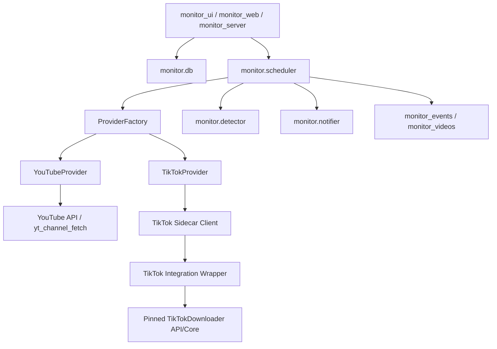

# TikTok 账号监控生产级接入实施方案

> 文档版本：v1
> 日期：2026-04-07
> 状态：实施设计
> 结论：采用“多平台 Provider 抽象 + `TikTokDownloader` Sidecar API + 一期只做监控不做 TikTok 自动下载”的方案
> 适用范围：基于当前仓库现有 `monitor/` 架构扩展 TikTok 账号发布作品监控能力
> 上游依赖：[JoeanAmier/TikTokDownloader](https://github.com/JoeanAmier/TikTokDownloader)

---

## 0. 决策摘要

当前项目可以在现有架构基础上增加 TikTok 账号监控，但不应直接把 `TikTokDownloader` 当作当前仓库内部模块深度嵌入。

推荐方案如下：

- 当前仓库继续负责：
  - 账户管理
  - 定时调度
  - 新内容去重
  - 事件记录
  - 通知推送
  - Web UI / 本地 UI / REST API
- `TikTokDownloader` 负责：
  - TikTok 账号数据采集
  - TikTok 风控参数与 Cookie 环境
  - TikTok 平台特有的请求细节
- 两者之间通过稳定的 Sidecar HTTP 接口对接，而不是共享内部类和数据库。

一期范围建议收敛为：

- 支持新增 TikTok 监控账户
- 支持定时扫描 TikTok 账号发布作品
- 支持发现新作品并入库
- 支持沿用现有通知体系发送提醒
- 支持在现有监控页面查询 TikTok 记录
- 明确不做 TikTok 自动下载

二期再做：

- TikTok 手动批量下载
- TikTok 扫描后自动下载
- TikTok 下载进度与代理路由并入当前下载管理

这是当前最稳、最容易上线、对现有 YouTube 功能破坏最小的路径。

---

## 1. 当前代码基线与可复用部分

### 1.1 当前已具备、可以直接复用的部分

| 模块 | 当前状态 | 对 TikTok 的价值 |
|---|---|---|
| `monitor/scheduler.py` | 已有定时扫描、事件记录、通知触发、自动下载开关 | 可直接复用调度骨架 |
| `monitor/db.py` | 已有账户、事件、视频、配置、通知日志等存储 | 可扩展为多平台模型 |
| `monitor/notifier.py` | 已有飞书/钉钉/企微通知 | 可直接复用消息投递链路 |
| `monitor_server.py` | 已有账户管理、手动扫描、视频分页查询 | 可扩展为多平台 REST API |
| `monitor_ui.py` / `monitor_web/` | 已有管理页面与交互骨架 | 可在原页面上增加平台字段 |
| `tests/` | 已有监控与 API 相关测试基线 | 可在现有测试风格下追加 TikTok 用例 |

### 1.2 当前与 TikTok 接入直接冲突的部分

| 模块 | 当前问题 | 必须改动点 |
|---|---|---|
| `monitor/fetcher.py` | 只实现了 `YouTubeFetcher`，且直接依赖 `YouTubeDataCollector` | 必须抽象为多平台 Provider |
| `monitor/scheduler.py` | 扫描时直接实例化 `YouTubeFetcher` | 必须改成通过工厂按平台分发 |
| `monitor/schema.sql` | `monitor_accounts` 只有 `channel_url` 语义；`monitor_videos.video_id` 全局唯一 | 必须增加 `platform` 并调整唯一索引 |
| `monitor_server.py` | 当前只校验 YouTube URL 和 YouTube 账户输入 | 必须增加 TikTok 校验与分平台参数处理 |
| `monitor_ui.py` | 表单字段写死为“频道 URL”和“YouTube API Key” | 必须改成平台感知表单 |
| `tests/test_monitor_channel_url_validation.py` | 当前只测 YouTube URL 校验 | 必须增加 TikTok 账户引用校验测试 |

---

## 2. 方案选型

### 2.1 方案对比

| 方案 | 描述 | 优点 | 缺点 |
|---|---|---|---|
| A | 直接 import 或复制 `TikTokDownloader` 内部代码到当前仓库 | 表面上只剩一个进程 | 耦合最高，升级最难，依赖差异大，风险最大 |
| B | 当前仓库调用 `TikTokDownloader` 已有 Web API | 与上游边界清晰，当前仓库改动可控 | 仍需要补一个“账号解析/健康检查”薄适配层 |
| C | 当前仓库通过 CLI/子进程驱动 `TikTokDownloader` | 最少 HTTP 对接工作 | 可观测性差，错误处理差，不适合生产运行 |

### 2.2 推荐方案

推荐采用 **方案 B**，并补一个极薄的 Sidecar 适配层。

原因：

- `TikTokDownloader` 已有可用的 Web API 能力，尤其是 `/tiktok/account`。
- 上游 README 已明确其 Web UI 尚未恢复，不适合作为集成入口。
- 上游也明确后续还会继续做结构重构，不适合把内部类当稳定 SDK 使用。
- 当前仓库更适合做“监控系统”，而不是“平台采集实现合集”。

### 2.3 为什么还需要一层薄适配

虽然上游已有 `/tiktok/account`，但直接用于当前项目仍存在一个生产级缺口：

- 当前用户通常输入的是 TikTok 账号主页 URL、短链或 `@unique_id`
- 上游公开 API 里没有一个专门稳定暴露的“账号引用 -> `sec_user_id`”解析接口
- 而 `/tiktok/account` 的输入核心是 `sec_user_id`

因此推荐的生产形态不是“当前仓库直接调用上游所有原始接口”，而是：

- 固定一个上游版本
- 在 Sidecar 层补一个很薄的适配封装
- 只对当前监控系统暴露我们真正需要的稳定接口

---

## 3. 范围、边界与非目标

### 3.1 一期目标

- 只支持 TikTok 账号“发布作品”监控
- 只支持基于 Sidecar API 的数据采集
- 只支持“发现新内容 -> 入库 -> 通知”
- 不修改现有 YouTube 下载链路

### 3.2 二期目标

- 支持 TikTok 手动批量下载
- 支持 TikTok 扫描后自动下载
- 支持 TikTok 下载任务与当前 `download-tasks` 统一展示

### 3.3 明确非目标

- 一期不支持 TikTok 喜欢作品监控
- 一期不支持 TikTok 合辑、直播、评论、搜索、热榜监控
- 一期不在当前仓库内存储 TikTok 原始 Cookie
- 一期不通过当前仓库动态改写 Sidecar 全局 `settings`
- 一期不要求当前仓库兼容多个 TikTok 账号各自独立 Cookie 配置

### 3.4 关键边界原则

- 当前仓库不直接依赖上游内部数据库
- 当前仓库不直接调用上游私有类作为稳定接口
- 当前仓库不将 TikTok 平台的认证、风控、msToken 等实现细节内嵌到自身
- 当前仓库只消费“已归一化的账号作品列表”

---

## 4. 推荐架构



### 4.1 当前仓库内部职责

| 层 | 职责 |
|---|---|
| UI/API 层 | 管理账户、展示记录、发起手动扫描 |
| 调度层 | 按账户配置定时触发扫描 |
| Provider 层 | 按平台调用不同采集源 |
| 检测层 | 判断哪些内容是新发现的 |
| 存储层 | 保存账户、事件、视频、配置 |
| 通知层 | 将新内容推送到飞书/钉钉/企微 |

### 4.2 TikTok Sidecar 职责

| 层 | 职责 |
|---|---|
| Wrapper 层 | 暴露稳定健康检查、账号解析、作品获取接口 |
| Upstream 层 | 使用 `TikTokDownloader` 实际完成 TikTok 数据采集 |
| Cookie/Proxy 层 | 由 Sidecar 自己维护 TikTok Cookie、代理和平台参数 |

### 4.3 不推荐的架构

不推荐让当前仓库做以下事情：

- 自己生成或维护 TikTok 请求参数
- 自己管理 `msToken` / `ttWid` / 浏览器环境参数
- 自己读写 `TikTokDownloader` 的数据库
- 在扫描过程中频繁改 Sidecar 的全局配置文件

---

## 5. Sidecar 部署形态与版本策略

### 5.1 推荐部署形态

推荐先采用 **外部 Sidecar 服务模式**。

即：

- `TikTokDownloader` 或其薄包装服务独立运行
- 当前监控系统只持有：
  - `base_url`
  - `token`
  - 超时配置
- 当前监控系统通过 HTTP 调用它

这比“当前仓库拉起子进程并长期管理”更稳，也更容易排查问题。

### 5.2 版本策略

必须固定上游版本，不允许使用“永远跟 master 最新”这种方式。

建议：

- 固定到明确的 release 或 commit
- 文档中记录版本号
- 将该版本写入当前项目的集成配置说明

原因：

- 上游 README 已明确后续还会继续重构代码结构
- 如果当前监控系统直接追上游最新，接口和输出字段可能无预警变化

### 5.3 Sidecar 最小稳定接口

推荐对当前项目只暴露下面 3 个接口：

#### 5.3.1 `GET /health`

用途：

- 健康检查
- 鉴权校验
- 启动就绪校验

返回示例：

```json
{
  "ok": true,
  "service": "tiktok-monitor-adapter",
  "upstream": "TikTokDownloader",
  "version": "x.y.z"
}
```

#### 5.3.2 `POST /v1/tiktok/account/resolve`

用途：

- 将用户输入的 TikTok 账号引用解析为稳定标识

请求示例：

```json
{
  "account_ref": "https://www.tiktok.com/@example"
}
```

返回示例：

```json
{
  "ok": true,
  "sec_user_id": "MS4wLjABAAAA...",
  "unique_id": "example",
  "nickname": "Example Account",
  "avatar_url": "https://..."
}
```

#### 5.3.3 `POST /v1/tiktok/account/videos`

用途：

- 获取某个 TikTok 账号在一个时间窗口内的作品列表

请求示例：

```json
{
  "sec_user_id": "MS4wLjABAAAA...",
  "mode": "post",
  "earliest": "2026/04/01",
  "latest": "2026/04/07",
  "pages": 3,
  "count": 16,
  "source_mode": "normalized"
}
```

返回示例：

```json
{
  "ok": true,
  "account": {
    "sec_user_id": "MS4wLjABAAAA...",
    "unique_id": "example",
    "nickname": "Example Account"
  },
  "items": [
    {
      "id": "7480000000000000001",
      "desc": "video title",
      "create_timestamp": 1775500000,
      "create_time": "2026-04-07 10:20:00",
      "type": "视频",
      "share_url": "https://www.tiktok.com/@example/video/7480000000000000001",
      "static_cover": "https://...",
      "downloads": "https://...",
      "duration": "00:00:18",
      "digg_count": 100,
      "comment_count": 20,
      "collect_count": 5,
      "share_count": 2,
      "play_count": 10000,
      "sec_uid": "MS4wLjABAAAA...",
      "unique_id": "example",
      "nickname": "Example Account"
    }
  ]
}
```

### 5.4 为什么不直接调用上游 `/tiktok/account`

不是不能，而是不够稳。

生产级问题主要有两个：

- 账号输入侧还缺稳定“解析接口”
- 当前项目只需要一小部分归一化字段，不希望把上游未来字段变化直接扩散进自身代码

因此推荐由 Wrapper 向当前项目提供稳定输出，内部再调用上游能力。

---

## 6. 数据库与配置模型改造

总原则：**在不推翻当前表结构的前提下，做最小可行的多平台扩展。**

### 6.1 `monitor_accounts` 表改造

建议新增字段：

```sql
ALTER TABLE monitor_accounts ADD COLUMN platform TEXT NOT NULL DEFAULT 'youtube';
ALTER TABLE monitor_accounts ADD COLUMN external_account_id TEXT DEFAULT NULL;
ALTER TABLE monitor_accounts ADD COLUMN external_account_handle TEXT DEFAULT NULL;
ALTER TABLE monitor_accounts ADD COLUMN provider_config_json TEXT NOT NULL DEFAULT '{}';
```

字段语义：

| 字段 | 用途 |
|---|---|
| `platform` | `youtube` 或 `tiktok` |
| `external_account_id` | YouTube 为 `channel_id`，TikTok 为 `sec_user_id` |
| `external_account_handle` | YouTube 为 handle，TikTok 为 `unique_id` |
| `provider_config_json` | 保存平台专有扫描参数 |

### 6.2 `monitor_accounts` 唯一约束改造

当前唯一索引是：

```sql
CREATE UNIQUE INDEX ... ON monitor_accounts(channel_url)
```

这在多平台下不够用，因为：

- `@same-name` 可能同时存在于 YouTube 和 TikTok
- 平台维度不同，不能共享唯一键

应改为：

```sql
DROP INDEX IF EXISTS idx_accounts_channel_url;
CREATE UNIQUE INDEX IF NOT EXISTS idx_accounts_platform_channel_url
ON monitor_accounts(platform, channel_url);
```

### 6.3 `api_key_env` 的兼容策略

当前字段仍可保留，但语义调整为：

- `platform = youtube` 时必须有效
- `platform = tiktok` 时允许为空字符串

为减少迁移冲击，建议：

- 一期不立即把 `api_key_env` 改为 `NULLABLE`
- TikTok 账户默认写空字符串 `""`
- 后端校验按平台区分

### 6.4 `monitor_videos` 表改造

建议新增字段：

```sql
ALTER TABLE monitor_videos ADD COLUMN platform TEXT NOT NULL DEFAULT 'youtube';
ALTER TABLE monitor_videos ADD COLUMN video_type TEXT DEFAULT NULL;
ALTER TABLE monitor_videos ADD COLUMN raw_payload_json TEXT DEFAULT NULL;
```

字段语义：

| 字段 | 用途 |
|---|---|
| `platform` | `youtube` 或 `tiktok` |
| `video_type` | `video` / `image_gallery` |
| `raw_payload_json` | 原始归一化输入的 JSON 快照，便于排障 |

### 6.5 `monitor_videos` 唯一约束改造

当前：

```sql
video_id TEXT NOT NULL UNIQUE
```

建议改为平台内唯一：

```sql
-- 重建表或迁移时转为：
UNIQUE(platform, video_id)
```

原因：

- 跨平台不应共用同一个 `video_id` 唯一空间
- 这是多平台去重的基础前提

### 6.6 TikTok 在现有字段中的落位

为降低一期改动，TikTok 内容建议沿用现有字段模型：

| 当前字段 | TikTok 写入规则 |
|---|---|
| `video_id` | 上游归一化结果中的 `id` |
| `channel_id` | `sec_uid` |
| `channel_handle` | `unique_id`，缺失时退回 `nickname` |
| `title` | `desc`，空时退回 `id` |
| `description` | `desc` |
| `url` | `share_url` |
| `published_at` | 由 `create_timestamp` 转 ISO8601 |
| `upload_date` | `published_at[:10]` |
| `duration_sec` | 由 `duration` 字符串转秒 |
| `view_count` | `play_count` |
| `like_count` | `digg_count` |
| `comment_count` | `comment_count` |
| `thumbnail_url` | `static_cover` |
| `video_type` | `type=视频 -> video`；`type=图集 -> image_gallery` |
| `raw_payload_json` | 完整归一化项 JSON |

### 6.7 `provider_config_json` 建议结构

TikTok 账户默认配置建议如下：

```json
{
  "scan_mode": "post",
  "initial_lookback_days": 7,
  "scan_pages": 3,
  "page_size": 16,
  "overlap_hours": 24,
  "source_mode": "normalized"
}
```

字段语义：

| 字段 | 说明 |
|---|---|
| `scan_mode` | 一期固定 `post` |
| `initial_lookback_days` | 首次扫描回看多少天 |
| `scan_pages` | 单次最多请求多少页 |
| `page_size` | 单页条数，默认对齐上游 TikTok 账号接口 |
| `overlap_hours` | 每次扫描相对于上次成功扫描时间额外重叠的小时数，避免漏数 |
| `source_mode` | 固定 `normalized`，表示消费 Wrapper 已归一化结果 |

### 6.8 全局配置新增项

建议在 `monitor/config.json` 增加：

```json
{
  "tiktok_sidecar_base_url": "http://127.0.0.1:5555",
  "tiktok_sidecar_token": "",
  "tiktok_sidecar_timeout_seconds": 20,
  "tiktok_default_initial_lookback_days": 7,
  "tiktok_default_scan_pages": 3,
  "tiktok_default_page_size": 16,
  "tiktok_default_overlap_hours": 24,
  "tiktok_fetch_max_concurrency": 2
}
```

### 6.9 配置加密要求

`tiktok_sidecar_token` 属于敏感信息，不应明文落盘。

当前仓库已对 Webhook 做了加密存储，但顶部配置还没有统一秘密字段加密框架。

因此建议同步改造：

- `monitor/db.py` 的 `save_config()` / `load_config()`
- 新增统一的配置秘密字段列表
- 将 `tiktok_sidecar_token` 纳入加密范围

---

## 7. 统一 Provider 抽象设计

### 7.1 新增文件建议

| 文件 | 职责 |
|---|---|
| `monitor/providers/base.py` | 定义 Provider 协议与通用模型 |
| `monitor/providers/models.py` | 定义统一的 `NormalizedMonitorItem` |
| `monitor/providers/factory.py` | 根据账户平台返回对应 Provider |
| `monitor/providers/youtube.py` | 包装现有 `YouTubeFetcher` |
| `monitor/providers/tiktok.py` | TikTok Provider，内部调用 Sidecar Client |
| `monitor/providers/tiktok_sidecar_client.py` | 负责 HTTP 调用和错误分类 |

### 7.2 `NormalizedMonitorItem` 建议结构

```python
@dataclass
class NormalizedMonitorItem:
    platform: str
    video_id: str
    channel_id: str | None
    channel_handle: str | None
    title: str
    description: str
    url: str
    published_at: str
    upload_date: str | None
    duration_sec: int | None
    view_count: int | None
    like_count: int | None
    comment_count: int | None
    thumbnail_url: str | None
    video_type: str | None
    fetched_at: str
    raw_payload_json: str | None
```

### 7.3 Provider 协议

```python
class MonitorProvider(Protocol):
    def validate_account_ref(self, account_ref: str) -> tuple[bool, str | None]:
        ...

    def bootstrap_account(self, account: dict) -> dict:
        ...

    def fetch_items(self, account: dict, scan_window: dict) -> tuple[list[NormalizedMonitorItem], dict | None]:
        ...
```

### 7.4 `YouTubeProvider` 的职责

- 保留当前 `YouTubeFetcher` 的获取逻辑
- 对外返回统一 `NormalizedMonitorItem`
- 当前 `monitor/fetcher.py` 可迁移为此 Provider 内部实现

### 7.5 `TikTokProvider` 的职责

- 校验 TikTok 账号输入
- 需要时调用 Sidecar 解析账号
- 计算扫描窗口
- 调用 Sidecar 获取作品
- 做字段归一化
- 做错误分类并返回

---

## 8. TikTok Sidecar Client 设计

### 8.1 `tiktok_sidecar_client.py` 必须做的事

| 能力 | 说明 |
|---|---|
| 健康检查 | 统一检测 Sidecar 是否可达、鉴权是否有效 |
| 账号解析 | 将 URL / `@unique_id` / 短链解析成 `sec_user_id` |
| 作品获取 | 按窗口取回作品 |
| 超时控制 | 避免卡死调度线程 |
| 错误分类 | 区分鉴权错误、网络错误、平台风控、结构变化 |
| 日志脱敏 | 不打印 token 和原始敏感参数 |

### 8.2 推荐错误分类

| 类别 | 条件 | 处理策略 |
|---|---|---|
| `sidecar_unreachable` | 连接失败、超时 | 事件标记失败，允许下次重试 |
| `sidecar_auth_failed` | 401/403 | 事件失败，不自动无限重试 |
| `account_resolve_failed` | 无法从账号引用得到 `sec_user_id` | 事件失败，提示用户检查账户地址 |
| `upstream_schema_changed` | Wrapper 返回结构缺关键字段 | 事件失败，需人工修复 |
| `upstream_empty_result` | 请求成功但返回空列表 | 允许视为成功但无新内容 |
| `upstream_rate_limited` | 明确风控或频率限制 | 事件失败，并建议延长扫描间隔 |

### 8.3 健康检查缓存

不要每个账户扫描前都重新探测 Sidecar。

建议：

- 健康检查结果缓存 60 秒
- 60 秒内复用同一状态
- 若缓存期内已经判定 Sidecar 不可用，则直接快速失败，避免所有账户都阻塞

### 8.4 并发限制

当前调度器是多账户并发的。

对 TikTok 来说，必须额外增加平台级并发限制。

建议：

- 新增 `asyncio.Semaphore` 或线程级信号量
- 默认 `tiktok_fetch_max_concurrency = 2`

这样可以避免：

- 单机同时打太多 TikTok 请求
- 同一个 Sidecar 被打爆
- 短时间内集中触发风控

---

## 9. TikTok 扫描流程设计

### 9.1 建议流程

```text
读取账户 -> 根据 platform 选择 Provider
       -> 若 TikTok 且 external_account_id 为空，则先 bootstrap
       -> 计算扫描窗口 earliest/latest
       -> 调用 Sidecar 获取归一化作品列表
       -> 统一映射为 NormalizedMonitorItem
       -> 按 (platform, video_id) 去重
       -> 插入 monitor_videos
       -> 结束事件
       -> 若有新增则发通知
```

### 9.2 扫描窗口算法

建议规则：

- 首次扫描：
  - `earliest = now - initial_lookback_days`
  - `latest = now`
- 非首次扫描：
  - `earliest = last_successful_scan_at - overlap_hours`
  - `latest = now`
- 最终将 `earliest` / `latest` 转成上游要求的 `YYYY/MM/DD`

这样做的目的：

- 首次扫描不会一次拉全量历史
- 后续扫描通过时间重叠避免边界时间漏数
- 即使平台返回顺序偶尔抖动，也还能被数据库去重兜住

### 9.3 为什么不能只靠“从上次扫描时间往后拉”

因为 TikTok 返回与实际发布时间之间可能存在：

- 时区处理差异
- 接口分页边界差异
- 平台短暂延迟

所以推荐：

- 时间窗口做重叠
- 数据库存储做最终去重

### 9.4 账号 Bootstrap 策略

在以下场景触发 `bootstrap_account`：

- 新建 TikTok 账户时
- 编辑账户并修改 `channel_url` 时
- 手动点击“重新解析账号”时
- 账户没有 `external_account_id` 时

Bootstrap 结果建议写回：

- `external_account_id = sec_user_id`
- `external_account_handle = unique_id`

### 9.5 手动扫描

现有 `POST /api/accounts/scan` 保持不变。

但对于 TikTok 账户：

- 走 `TikTokProvider`
- 不触发自动下载
- 若用户勾选“立即下载”，直接返回清晰错误提示

建议提示文案：

`TikTok 自动下载尚未实现，本次仅执行监控扫描。`

---

## 10. TikTok 输入校验与 API/UI 改造

### 10.1 后端校验

当前后端只支持 YouTube 账户输入校验。

需新增：

```python
def _is_valid_tiktok_account_ref(value: str) -> bool:
    """
    支持：
    - https://www.tiktok.com/@example
    - https://vt.tiktok.com/xxxx/
    - @example
    - MS4wLjABAAAA...  # 高级用户可直接填 sec_user_id
    """
```

校验原则：

- 不接受单个视频详情 URL 作为“账号监控地址”
- 不接受空字符串
- 不接受非 TikTok 域名

### 10.2 账户 API 改造

`POST /api/accounts` 请求体建议新增字段：

```json
{
  "platform": "tiktok",
  "channel_url": "https://www.tiktok.com/@example",
  "provider_config": {
    "scan_mode": "post",
    "initial_lookback_days": 7,
    "scan_pages": 3,
    "page_size": 16,
    "overlap_hours": 24
  }
}
```

YouTube 账户仍沿用现有结构。

### 10.3 返回值改造

`GET /api/accounts` 需增加：

- `platform`
- `external_account_id`
- `external_account_handle`
- `provider_config`

### 10.4 全局配置 API 改造

`GET /api/config` / `POST /api/config` 需支持：

- `tiktok_sidecar_base_url`
- `tiktok_sidecar_timeout_seconds`
- `tiktok_default_initial_lookback_days`
- `tiktok_default_scan_pages`
- `tiktok_default_page_size`
- `tiktok_default_overlap_hours`
- `tiktok_fetch_max_concurrency`

### 10.5 Web UI / 本地 UI 改造

账户表单新增 `platform` 下拉框：

- `YouTube`
- `TikTok`

字段显示逻辑：

| 平台 | 显示字段 |
|---|---|
| YouTube | 保留当前字段，包括 API Key |
| TikTok | 账号地址、初始回看天数、扫描页数、每页条数、重叠小时数 |

TikTok 平台下：

- 不显示 YouTube API Key 字段
- 不显示 YouTube 专属 URL 提示
- 页面文案从“频道 URL”改为更通用的“账户地址”

### 10.6 全局配置页新增 Sidecar 状态区

建议新增一个只读状态块：

- Sidecar 地址
- 最近一次健康检查状态
- 最近一次失败原因
- 测试连接按钮

---

## 11. 归一化映射与去重设计

### 11.1 TikTok 归一化字段映射

优先消费 Wrapper 已经整理过的字段。

如果仍直接面向上游归一化输出，则映射规则如下：

| 上游字段 | 当前项目字段 | 备注 |
|---|---|---|
| `id` | `video_id` | 必填 |
| `desc` | `title` / `description` | 为空时回退 `id` |
| `create_timestamp` | `published_at` | 转 ISO8601 |
| `create_time` | `upload_date` | 可直接截取日期 |
| `share_url` | `url` | 优先使用 |
| `static_cover` | `thumbnail_url` | 优先使用 |
| `duration` | `duration_sec` | 需将 `HH:MM:SS` 转秒 |
| `play_count` | `view_count` | 整数化 |
| `digg_count` | `like_count` | 整数化 |
| `comment_count` | `comment_count` | 整数化 |
| `type` | `video_type` | `视频`/`图集` 映射到内部枚举 |
| `sec_uid` | `channel_id` | 一期复用旧字段 |
| `unique_id` / `nickname` | `channel_handle` | 优先 `unique_id` |

### 11.2 `duration` 处理

TikTok 归一化输出中的 `duration` 是字符串，不是秒。

因此当前仓库必须新增：

- TikTok 专用的时长解析函数
- 支持 `HH:MM:SS` 与 `MM:SS`

### 11.3 去重规则

去重键统一为：

```text
(platform, video_id)
```

`monitor.detector.detect_new()` 也要同步调整，不能只按 `video_id` 查询。

### 11.4 为什么不使用“URL 去重”

因为：

- 平台 URL 形式可能变化
- 图集与视频 URL 形态不同
- 短链和长链可能指向同一作品

`video_id` 才是更稳定的业务主键。

---

## 12. 通知、日志与事件语义

### 12.1 通知层复用原则

一期 TikTok 不需要重写通知模块，只需要：

- 统一写入当前 `monitor_videos`
- 统一调用当前 `monitor.notifier`

### 12.2 文案建议

通知文案里建议增加平台标识：

- `[YouTube]`
- `[TikTok]`

这样能避免多平台并行后消息难以区分。

### 12.3 事件日志

`monitor_events` 现有结构可以继续使用。

但建议在日志文案中明确写平台，例如：

- `扫描开始: 平台=tiktok 账户=example`
- `扫描完成: 平台=tiktok API返回=10 新增=2`

### 12.4 Sidecar 失败时的事件状态

建议：

- Sidecar 不可达、鉴权失败、账号解析失败，都记为 `error`
- `error_message` 中写清楚错误类别，而不是只写原始异常

例如：

- `TikTok sidecar unreachable`
- `TikTok sidecar auth failed`
- `TikTok account resolve failed`

---

## 13. 一期不做 TikTok 自动下载的原因与保留位

### 13.1 不在一期实现的原因

当前下载链路完全围绕 YouTube 设计：

- 调度自动下载直接调用 `Youtube_Downloader.batch_download`
- 手动批量下载接口也直接走当前 YouTube 下载器
- 下载代理路由目前也是围绕 YouTube 下载行为建立的

如果一期同时做 TikTok 自动下载，会带来以下额外工作：

- 定义 TikTok 下载任务接口
- 定义 TikTok 下载状态与结果结构
- 处理图集与视频两类文件产物
- 统一下载进度展示

这会显著扩大改动面，增加上线风险。

### 13.2 一期保留位

建议现在先把接口留出来：

- 数据层保留 `platform`
- 视频记录保留 `video_type`
- 下载接口收到 TikTok 账户请求时给出明确提示

这样二期接入时，不需要再重做表结构。

### 13.3 二期推荐做法

二期建议也继续使用 Sidecar 方式，而不是让当前仓库自己下载 TikTok。

即：

- 当前仓库发起下载任务请求
- Sidecar 负责实际下载
- 当前仓库只做任务状态轮询和展示

---

## 14. 安全、稳定性与运维要求

### 14.1 Cookie 管理原则

一期不要在当前仓库存储 TikTok 原始 Cookie。

推荐方式：

- TikTok Cookie 完全由 Sidecar 自己维护
- 当前仓库只知道 Sidecar 的地址和 token

好处：

- 降低敏感信息扩散范围
- 不必在当前仓库里新增 TikTok Cookie 读写逻辑
- 避免多系统之间同步 Cookie

### 14.2 Sidecar Token 管理

- `tiktok_sidecar_token` 必须加密落盘
- 日志中不得打印 token
- HTTP 错误日志中不得回显完整鉴权头

### 14.3 调度隔离

TikTok 账户的扫描失败不能影响 YouTube 账户。

因此：

- Provider 层异常必须局部捕获
- 单个账户失败只影响自己的事件记录
- 当前调度器整体状态不能因 TikTok 失败而停摆

### 14.4 超时与熔断建议

推荐默认值：

- Sidecar 请求超时：20 秒
- 连续 3 次 Sidecar 不可达后，进入 5 分钟快速失败窗口
- 快速失败窗口期间，TikTok 账户直接跳过真实请求并写入清晰错误

### 14.5 日志建议

建议新增 logger 名称：

- `monitor.providers.tiktok`
- `monitor.providers.tiktok_sidecar`

日志关键字段：

- `platform`
- `account_id`
- `channel_url`
- `external_account_id`
- `sidecar_base_url`
- `request_timeout`
- `items_returned`
- `new_items`
- `error_category`

### 14.6 法务与许可证提醒

上游项目许可证与当前项目后续分发方式需要单独评估。

本文只做技术方案，不做法律结论。

上线前必须明确：

- 当前项目是否分发
- 分发时是否与 Sidecar 一起打包
- 是否需要许可证声明与源码提供义务

---

## 15. 代码改动清单

### 15.1 当前仓库新增文件

| 文件 | 说明 |
|---|---|
| `monitor/providers/base.py` | Provider 协议 |
| `monitor/providers/models.py` | 统一归一化模型 |
| `monitor/providers/factory.py` | 平台工厂 |
| `monitor/providers/youtube.py` | YouTube Provider |
| `monitor/providers/tiktok.py` | TikTok Provider |
| `monitor/providers/tiktok_sidecar_client.py` | Sidecar HTTP 客户端 |
| `tests/test_tiktok_sidecar_client.py` | Sidecar 客户端测试 |
| `tests/test_tiktok_provider.py` | TikTok Provider 测试 |
| `tests/test_tiktok_account_validation.py` | TikTok 输入校验测试 |
| `tests/test_tiktok_db_migration.py` | 多平台数据库迁移测试 |

### 15.2 当前仓库修改文件

| 文件 | 主要改动 |
|---|---|
| `monitor/schema.sql` | 增加多平台字段与新索引 |
| `monitor/db.py` | 增加 migration、配置加密、账户读写扩展 |
| `monitor/detector.py` | 去重逻辑改为 `(platform, video_id)` |
| `monitor/scheduler.py` | 改为通过 ProviderFactory 扫描 |
| `monitor_server.py` | 账户 API、配置 API、平台校验改造 |
| `monitor_ui.py` | 表单平台化 |
| `monitor_web/index.html` | Web UI 表单平台化 |
| `README.md` | 补充 TikTok 监控说明 |

### 15.3 Sidecar 侧工作包

推荐作为单独工作包执行：

| 工作项 | 说明 |
|---|---|
| 固定上游版本 | 锁定可用 release/commit |
| 提供 `/health` | 健康检查与鉴权测试 |
| 提供 `/v1/tiktok/account/resolve` | 账号引用解析 |
| 提供 `/v1/tiktok/account/videos` | 归一化作品列表输出 |
| 统一错误格式 | 便于当前项目分类处理 |

---

## 16. 分阶段实施计划

### Phase A：多平台数据层与 Provider 抽象

目标：

- 数据表支持 `platform`
- 引入 ProviderFactory
- YouTube 行为保持不变

完成标准：

- 所有现有 YouTube 测试通过
- 新表迁移可重复执行
- `platform=youtube` 账户完全兼容旧逻辑

### Phase B：TikTok Sidecar Client 与扫描链路

目标：

- Sidecar 健康检查
- TikTok 账户 bootstrap
- TikTok 作品获取与归一化
- 事件入库与通知跑通

完成标准：

- 单个 TikTok 账户可手动扫描成功
- 能正确插入 `monitor_videos`
- 通知能正常发出

### Phase C：REST API 与 UI 改造

目标：

- 前后端支持平台字段
- 配置页支持 Sidecar 参数
- 账户页支持 TikTok 录入和查看

完成标准：

- Web UI 可新增、编辑、删除 TikTok 账户
- 本地 UI 可新增、编辑、删除 TikTok 账户
- YouTube 页面行为不退化

### Phase D：二期下载能力

目标：

- TikTok 手动批量下载
- TikTok 自动下载
- 下载任务统一展示

完成标准：

- TikTok 下载链路不影响 YouTube 下载链路
- 支持图集与视频两类结果

---

## 17. 测试与验收矩阵

### 17.1 单元测试

| 测试项 | 验收点 |
|---|---|
| TikTok 账户输入校验 | URL、短链、`@id`、`sec_user_id` 校验正确 |
| Sidecar 健康检查 | 正常、超时、401、403、500 分类正确 |
| 账号 bootstrap | URL 能解析为 `sec_user_id` 并回写账户 |
| 归一化映射 | 上游返回字段正确映射到 `NormalizedMonitorItem` |
| 时长解析 | `duration` 字符串正确转秒 |
| 去重逻辑 | `(platform, video_id)` 正确去重 |

### 17.2 集成测试

| 测试项 | 验收点 |
|---|---|
| 新建 TikTok 账户 | 账户成功保存并完成 bootstrap |
| 手动扫描 TikTok 账户 | 成功写入事件和视频 |
| 重复扫描同一窗口 | 不重复入库 |
| Sidecar 不可用 | 事件失败但调度器不中断 |
| TikTok 与 YouTube 混合存在 | 两类账户都可独立工作 |

### 17.3 回归测试

以下现有测试必须继续通过：

- [test_batch_download_api.py](/D:/WORKSPACE/video-download-space/ytdlp-batch-downloader/tests/test_batch_download_api.py)
- [test_monitor_duration.py](/D:/WORKSPACE/video-download-space/ytdlp-batch-downloader/tests/test_monitor_duration.py)
- [test_monitor_server_static_auth.py](/D:/WORKSPACE/video-download-space/ytdlp-batch-downloader/tests/test_monitor_server_static_auth.py)
- [test_api_key_crud.py](/D:/WORKSPACE/video-download-space/ytdlp-batch-downloader/tests/test_api_key_crud.py)
- 动态代理相关测试全量回归

### 17.4 验收标准

- [ ] 可以新增 TikTok 账户
- [ ] 可以手动扫描 TikTok 账户
- [ ] 可以定时扫描 TikTok 账户
- [ ] 新内容能正确去重
- [ ] 能正常发通知
- [ ] YouTube 功能无回归
- [ ] Sidecar 不可用时系统可控失败
- [ ] 所有敏感配置都已加密或留在 Sidecar 内

---

## 18. 上线与回滚策略

### 18.1 上线策略

- 先灰度启用 TikTok 功能，只对新建 `platform=tiktok` 账户开放
- 现有 YouTube 账户完全不变
- 先手动扫描验证，再开启定时任务

### 18.2 回滚策略

如 TikTok 功能异常，可按以下粒度回滚：

1. 禁止新增 TikTok 账户
2. 停止所有 `platform=tiktok` 账户调度
3. 保留数据库字段，不影响 YouTube
4. 当前 ProviderFactory 直接不返回 `TikTokProvider`

这样可以做到：

- 不需要回滚整个监控系统
- 不需要影响现有 YouTube 用户

---

## 19. 最终建议

实施时请严格按以下顺序推进：

1. 先做多平台数据层与 Provider 抽象
2. 再做 TikTok Sidecar Client 与 bootstrap
3. 跑通“手动扫描 -> 入库 -> 通知”
4. 再改 API 和 UI
5. 最后再考虑 TikTok 下载

最重要的三条原则：

- 不把 `TikTokDownloader` 深度嵌到当前仓库内部
- 不在当前仓库存 TikTok 原始 Cookie
- 不把 TikTok 下载和 TikTok 监控一期一起做

只要守住这三条，当前项目就在较低风险下把 TikTok 账号监控落地。
