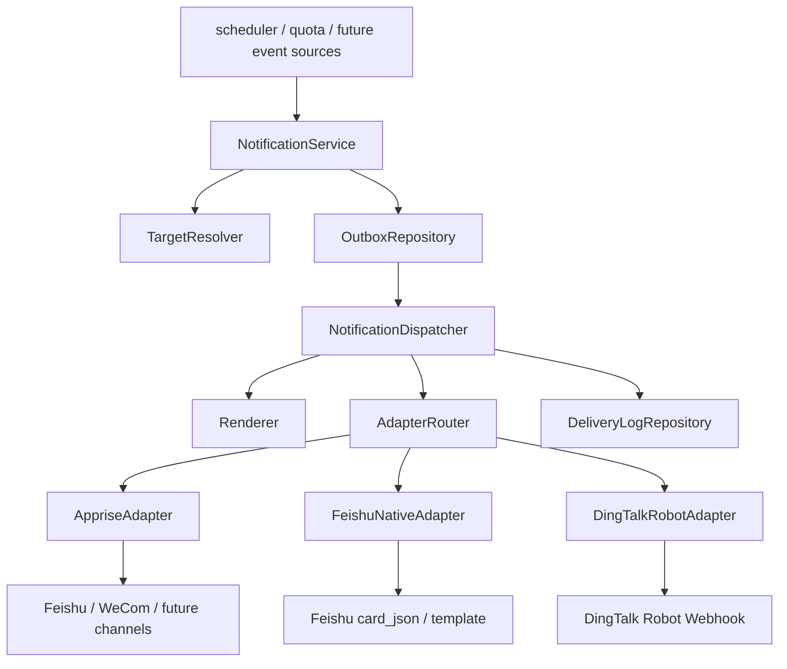

# Apprise 混合通知架构落地设计

> 文档版本：v1
> 日期：2026-04-07
> 状态：实施设计
> 结论：采用“Apprise 统一分发层 + 原生适配器保留”的混合方案

---

## 0. 决策摘要

当前项目可以引入 Apprise，但不应将现有通知逻辑直接替换为“全部走 Apprise 原生插件”。

推荐方案：

- 用 **Apprise** 统一承接通用通知分发能力，包括目标标准化、多目标发送、通用重试、后续扩展。
- 保留 **原生适配器** 承接 Apprise 不适合直接替换的能力，尤其是：
  - 飞书 `card_json`
  - 飞书 `template`
  - 当前钉钉机器人 Webhook
- 配置与状态的**主数据仍由本项目数据库维护**，不以 Apprise 配置文件作为系统事实来源。

这样做的核心价值：

- 不会丢失当前飞书富卡片能力。
- 能把 `scheduler`、`notifier`、`quota` 三条分散链路统一起来。
- 能从“单账户单目标”平滑升级到“单账户多目标”。
- 能逐步迁移，不打碎现有 CLI、桌面 UI、Web UI 和 API。

---

## 1. 设计目标与非目标

### 1.1 设计目标

| 目标 | 说明 |
|---|---|
| 统一发送入口 | 新视频通知、Quota 预警、后续扫描确认都走同一通知服务 |
| 支持多目标 | 一个账户可同时发到多个目标，而不是只能发一个 `platform + webhook` |
| 保留现有飞书能力 | 飞书卡片和模板能力继续可用，不因接入 Apprise 而退化 |
| 渐进迁移 | 不要求一次性改完 UI / API / CLI / DB |
| 可观测 | 记录每次发送、每次重试、失败原因、目标快照 |
| 可恢复 | 进程重启后仍可继续处理待重试通知 |
| 安全 | URL/Token 继续加密存储，日志中只保留脱敏信息 |

### 1.2 非目标

| 非目标 | 说明 |
|---|---|
| 一期内移除所有旧字段 | `notify_platform`、`webhook_url` 等旧字段一期仍保留 |
| 一期内重做全部前端 | 先后端落地，前端可以分阶段跟进 |
| 一期内所有平台都强制走 Apprise | 飞书富卡片与钉钉机器人先走原生适配更稳 |
| 将通知系统拆成独立微服务 | 当前项目体量和运行形态不需要先走 sidecar / 外部服务 |

---

## 2. 外部约束与能力边界

### 2.1 Apprise 官方能力边界

当前设计基于以下官方资料判断：

- [Apprise Feishu](https://appriseit.com/services/feishu/)
- [Apprise WeCom Bot](https://appriseit.com/services/wecombot/)
- [Apprise Configuration](https://appriseit.com/getting-started/configuration/)
- [Apprise Extending via Decorator](https://appriseit.com/library/extending/decorator/)

基于这些资料，当前工程判断如下：

| 项目 | 判断 | 设计含义 |
|---|---|---|
| 飞书 | Apprise 可接入 | 可作为通用飞书文本/Markdown 分发通道 |
| 企微机器人 | Apprise 可接入 | 可优先纳入 Apprise 分发 |
| 钉钉 | 官方页面并不等价于当前项目使用的“机器人 Webhook”能力 | 当前钉钉机器人不建议直接替换为 Apprise 原生能力 |
| Apprise 扩展 | 支持自定义扩展 | 若后续需要“统一表面全走 Apprise”，可以再补自定义插件 |
| Apprise 配置文件 | 能表达通知目标，但不适合作为本项目的配置主来源 | 本项目仍应以 DB + API + UI 为主配置源 |

### 2.2 对本项目的直接约束

- 当前项目已经有飞书专用字段和模板模式，不能直接抹平。
- 当前项目是 Windows + PowerShell + PyInstaller 场景，新增依赖必须考虑打包。
- 当前通知逻辑分布在 `monitor/scheduler.py`、`monitor/notifier.py`、`monitor/quota.py`、`monitor_server.py`、`monitor_ui.py`、`monitor_web/index.html` 中，改动需要可分阶段收敛。

---

## 3. 当前问题总结

| 问题 | 当前状态 | 风险 |
|---|---|---|
| 发送入口分散 | 新视频走 `monitor.notifier`，Quota 预警走 `monitor.quota` | 逻辑重复，不一致 |
| 目标模型过于简单 | 账户只能配置一个 `notify_platform + webhook_url` | 无法多目标 |
| 平台分支渗透太深 | 飞书模板字段出现在 DB / API / CLI / UI | 后续扩展成本高 |
| 失败处理不足 | 当前发送多为单次请求，失败后状态回写不完整 | 无法稳定运行 |
| 发送日志过粗 | 仅有较粗粒度 `monitor_notify_logs` | 不利于排障 |
| Quota 报警硬编码飞书格式 | 不是真正的平台无关消息 | 其他平台行为不可控 |

---

## 4. 目标架构



### 4.1 核心原则

- 业务代码只产生“通知事件”，不直接处理平台细节。
- 目标解析、消息渲染、发送、重试、回写统一收口到通知服务。
- Apprise 是“分发能力”，不是“系统主配置中心”。
- 飞书卡片和钉钉机器人使用原生适配器，避免能力丢失。

### 4.2 推荐发送路径

| 事件类型 | 推荐默认适配器 | 说明 |
|---|---|---|
| `new_video` | 飞书卡片走 `feishu_native`；企微机器人走 `apprise`；钉钉机器人走 `dingtalk_robot` | 保留现有体验 |
| `quota_alert` | 通用文本优先走 `apprise`；钉钉机器人例外走原生 | 先统一事件，再按目标分发 |
| `scan_summary` | 通用文本优先走 `apprise` | 当前功能未启用，但可直接纳入统一体系 |
| `test` | 按目标适配器走 | 用于配置验证 |

---

## 5. 模块边界设计

建议新增目录：

```text
monitor/
  notification/
    __init__.py
    models.py
    repository.py
    resolver.py
    renderer.py
    policy.py
    service.py
    dispatcher.py
    adapters/
      __init__.py
      base.py
      apprise_adapter.py
      feishu_native_adapter.py
      dingtalk_robot_adapter.py
```

### 5.1 模块职责表

| 模块 | 职责 | 不负责 |
|---|---|---|
| `models.py` | 定义事件、目标、订阅、投递结果数据结构 | 不访问数据库 |
| `repository.py` | 读写通知相关表 | 不决定发送策略 |
| `resolver.py` | 按账户 / 系统范围解析匹配到的目标和订阅 | 不直接发消息 |
| `renderer.py` | 将 `NotificationEvent` 渲染为文本、Markdown、飞书卡片数据 | 不发请求 |
| `policy.py` | 统一重试、超时、幂等、错误分类策略 | 不做具体渲染 |
| `service.py` | 通知统一入口；接收业务事件；写出站队列；触发分发 | 不知道具体平台实现细节 |
| `dispatcher.py` | 从出站队列取任务，按目标逐个发送，记录结果与重试 | 不生成业务事件 |
| `adapters/apprise_adapter.py` | 将通用消息送入 Apprise | 不处理飞书卡片模板 |
| `adapters/feishu_native_adapter.py` | 发送飞书 `card_json` / `template` | 不负责通用多渠道 |
| `adapters/dingtalk_robot_adapter.py` | 发送当前钉钉机器人 Webhook | 不负责其他渠道 |

### 5.2 现有模块改造边界

| 现有文件 | 改造后职责 |
|---|---|
| `monitor/notifier.py` | 变成兼容门面，内部转调 `NotificationService` |
| `monitor/quota.py` | 只构建 `quota_alert` 事件，不再自己发 HTTP |
| `monitor/scheduler.py` | 只负责扫描业务，不再自己拼平台分支 |
| `monitor_server.py` | 增加通知管理 API；兼容旧接口映射 |
| `monitor_ui.py` | 一期保留旧配置录入；二期升级为多目标管理 |
| `monitor_web/index.html` | 一期保留旧字段；二期升级为多目标管理 |
| `YouTubeMonitor.spec` | 补充 `apprise` 与新模块的打包导入 |

---

## 6. 数据模型设计

### 6.1 设计原则

- 新表承接未来能力，旧字段先保留。
- “目标”和“订阅”分离，避免一个目标只能绑定一种事件。
- 用出站表承接重试与断点恢复。
- 用投递明细表承接可观测与排障。

### 6.2 新增表一：`notification_targets`

用途：定义一个实际通知目标。

```sql
CREATE TABLE IF NOT EXISTS notification_targets (
    id                INTEGER PRIMARY KEY AUTOINCREMENT,
    name              TEXT    NOT NULL,
    adapter_key       TEXT    NOT NULL,              -- apprise | feishu_native | dingtalk_robot
    channel_key       TEXT    NOT NULL,              -- feishu | dingtalk | wecom | generic
    destination_enc   TEXT    NOT NULL,              -- 加密后的 webhook / apprise url
    destination_hint  TEXT    NOT NULL,              -- 脱敏后的展示信息
    config_json       TEXT    NOT NULL DEFAULT '{}', -- 适配器扩展配置
    enabled           INTEGER NOT NULL DEFAULT 1,
    created_at        TEXT    NOT NULL,
    updated_at        TEXT    NOT NULL
);

CREATE INDEX IF NOT EXISTS idx_notification_targets_enabled
    ON notification_targets(enabled);
```

字段建议：

| 字段 | 说明 |
|---|---|
| `adapter_key` | 决定走 Apprise 还是原生适配器 |
| `channel_key` | 目标属于飞书、钉钉、企微还是通用渠道 |
| `destination_enc` | 统一保存敏感地址；复用现有加密能力 |
| `destination_hint` | 只保存脱敏后的域名或平台提示，供 UI 和日志展示 |
| `config_json` | 存飞书模板 ID、body_format、标题前缀等扩展配置 |

示例：

```json
{
  "body_format": "markdown",
  "title_prefix": "YouTube Monitor",
  "feishu_message_mode": "template",
  "feishu_template_id": "ctp_xxx",
  "feishu_scan_template_id": "ctp_scan_xxx"
}
```

### 6.3 新增表二：`notification_subscriptions`

用途：将事件类型绑定到目标，可按系统级或账户级订阅。

```sql
CREATE TABLE IF NOT EXISTS notification_subscriptions (
    id                  INTEGER PRIMARY KEY AUTOINCREMENT,
    scope_type          TEXT    NOT NULL,              -- system | account
    scope_id            INTEGER DEFAULT NULL,          -- system 时为 NULL，account 时为 monitor_accounts.id
    target_id           INTEGER NOT NULL,
    event_type          TEXT    NOT NULL,              -- new_video | quota_alert | scan_summary | test
    profile_key         TEXT    NOT NULL,              -- generic_markdown | feishu_card | feishu_template
    filter_json         TEXT    NOT NULL DEFAULT '{}', -- 后续可做频道过滤、级别过滤
    policy_json         TEXT    NOT NULL DEFAULT '{}', -- mandatory/max_attempts/timeout 等
    priority            INTEGER NOT NULL DEFAULT 100,
    enabled             INTEGER NOT NULL DEFAULT 1,
    created_at          TEXT    NOT NULL,
    updated_at          TEXT    NOT NULL,
    FOREIGN KEY (target_id) REFERENCES notification_targets(id) ON DELETE CASCADE
);

CREATE UNIQUE INDEX IF NOT EXISTS idx_notification_subscriptions_scope_target_event
    ON notification_subscriptions(scope_type, scope_id, target_id, event_type);
```

字段建议：

| 字段 | 说明 |
|---|---|
| `scope_type + scope_id` | 表示系统默认订阅或账户专属订阅 |
| `profile_key` | 决定这条订阅使用哪种消息外观 |
| `filter_json` | 为后续做更细粒度事件过滤留扩展位 |
| `policy_json` | 为这条订阅单独覆盖重试、超时、是否强制成功等策略 |

### 6.4 新增表三：`notification_outbox`

用途：保存待发送通知事件，支持幂等、重试和进程重启恢复。

```sql
CREATE TABLE IF NOT EXISTS notification_outbox (
    id                INTEGER PRIMARY KEY AUTOINCREMENT,
    event_key         TEXT    NOT NULL UNIQUE,         -- 幂等键
    event_type        TEXT    NOT NULL,
    account_id        INTEGER DEFAULT NULL,
    source_type       TEXT    NOT NULL,                -- monitor_event | quota_usage | system
    source_id         INTEGER DEFAULT NULL,
    payload_json      TEXT    NOT NULL,
    aggregate_status  TEXT    NOT NULL DEFAULT 'pending', -- pending | processing | sent | partial | failed | discarded
    attempt_count     INTEGER NOT NULL DEFAULT 0,
    max_attempts      INTEGER NOT NULL DEFAULT 3,
    available_at      TEXT    NOT NULL,
    locked_at         TEXT    DEFAULT NULL,
    last_error        TEXT    DEFAULT NULL,
    created_at        TEXT    NOT NULL,
    updated_at        TEXT    NOT NULL
);

CREATE INDEX IF NOT EXISTS idx_notification_outbox_status_available
    ON notification_outbox(aggregate_status, available_at);
```

`event_key` 建议规则：

| 事件 | 幂等键建议 |
|---|---|
| `new_video` | `new_video:{event_id}` |
| `quota_alert` | `quota_alert:{api_key_hash}:{date}:{threshold}` |
| `scan_summary` | `scan_summary:{account_id}:{scan_started_at}` |
| `test` | `test:{target_id}:{timestamp}` |

### 6.5 新增表四：`notification_deliveries`

用途：记录每个目标的实际投递过程与结果。

```sql
CREATE TABLE IF NOT EXISTS notification_deliveries (
    id                 INTEGER PRIMARY KEY AUTOINCREMENT,
    outbox_id          INTEGER NOT NULL,
    subscription_id    INTEGER NOT NULL,
    target_id          INTEGER NOT NULL,
    adapter_key        TEXT    NOT NULL,
    channel_key        TEXT    NOT NULL,
    profile_key        TEXT    NOT NULL,
    destination_hint   TEXT    NOT NULL,
    status             TEXT    NOT NULL DEFAULT 'pending', -- pending | sending | sent | retrying | failed | discarded
    attempt_no         INTEGER NOT NULL DEFAULT 0,
    http_status        INTEGER DEFAULT NULL,
    response_excerpt   TEXT    DEFAULT NULL,
    error_message      TEXT    DEFAULT NULL,
    next_retry_at      TEXT    DEFAULT NULL,
    started_at         TEXT    DEFAULT NULL,
    finished_at        TEXT    DEFAULT NULL,
    created_at         TEXT    NOT NULL,
    FOREIGN KEY (outbox_id) REFERENCES notification_outbox(id) ON DELETE CASCADE,
    FOREIGN KEY (subscription_id) REFERENCES notification_subscriptions(id) ON DELETE CASCADE,
    FOREIGN KEY (target_id) REFERENCES notification_targets(id) ON DELETE CASCADE
);

CREATE INDEX IF NOT EXISTS idx_notification_deliveries_outbox
    ON notification_deliveries(outbox_id);

CREATE INDEX IF NOT EXISTS idx_notification_deliveries_status_retry
    ON notification_deliveries(status, next_retry_at);
```

### 6.6 旧表与旧字段如何兼容

一期不删除以下结构：

| 现有结构 | 一期策略 |
|---|---|
| `monitor_accounts.notify_enabled` | 保留，继续可用 |
| `monitor_accounts.notify_platform` | 保留，作为旧 UI / API 输入 |
| `monitor_accounts.webhook_url` | 保留，作为旧 UI / API 输入 |
| `monitor_accounts.feishu_message_mode` | 保留，作为飞书专有输入 |
| `monitor_accounts.feishu_template_id` | 保留 |
| `monitor_accounts.feishu_scan_template_id` | 保留 |
| `config.json` 中 `global_feishu_url/global_dingtalk_url/global_wecom_url` | 保留 |
| `monitor_notify_logs` | 保留，兼容旧查询；一期建议双写 |

### 6.7 `monitor_videos.notify_status` 的新语义

当前字段无法原生表达“一个视频对应多个通知目标”的状态，建议采用聚合语义：

| 值 | 含义 |
|---|---|
| `pending` | 还有至少一个目标待发送或待重试 |
| `sent` | 所有启用且匹配的目标均发送成功 |
| `failed` | 至少一个必达目标最终失败 |
| `skipped` | 没有匹配的订阅或通知被显式关闭 |
| `partial` | 可选，二期引入，用于区分“部分成功” |

说明：

- SQLite 不限制枚举值，一期即可安全引入 `partial`，但 UI 不必立即展示。
- 真正精确的状态应以 `notification_deliveries` 为准，`monitor_videos.notify_status` 只作为聚合摘要。

---

## 7. 适配器策略

### 7.1 `AppriseAdapter`

适用场景：

- 企微机器人
- 飞书通用文本/Markdown
- 后续新增的其他 Apprise 支持渠道

职责：

- 接收统一渲染后的 `title + body + body_format`
- 运行时根据 `destination_enc` 生成 Apprise URL
- 调用 Apprise 发送
- 将结果映射回统一 `DeliveryResult`

不做的事：

- 不负责飞书卡片 JSON
- 不负责飞书模板变量拼装
- 不负责钉钉机器人兼容层

### 7.2 `FeishuNativeAdapter`

适用场景：

- `feishu_message_mode = card_json`
- `feishu_message_mode = template`

职责：

- 复用现有飞书卡片和模板构建逻辑
- 兼容当前卡片展示效果
- 统一返回标准化投递结果

### 7.3 `DingTalkRobotAdapter`

适用场景：

- 当前项目已有钉钉机器人 Webhook

职责：

- 保留当前钉钉机器人消息格式
- 避免一期内为统一外观而牺牲可用性

后续选项：

- 如果未来希望“表面上全部走 Apprise”，可在稳定后补自定义 Apprise 插件，再将该适配器收敛掉。

---

## 8. 消息渲染策略

### 8.1 统一事件模型

建议统一为以下事件类型：

| `event_type` | 触发来源 | 主要字段 |
|---|---|---|
| `new_video` | 扫描发现新视频 | `account_id`、`event_id`、`videos[]`、`channel_name` |
| `quota_alert` | 配额达到阈值 | `api_key_mask`、`usage`、`budget`、`threshold` |
| `scan_summary` | 扫描结束 | `account_id`、`total_videos`、`new_videos`、`duration_ms` |
| `test` | 手动测试通知 | `title`、`body` |

### 8.2 `profile_key` 建议

| `profile_key` | 适配目标 |
|---|---|
| `generic_markdown` | Apprise 通用 Markdown / 文本 |
| `generic_text` | 纯文本渠道 |
| `feishu_card` | 飞书 `card_json` |
| `feishu_template` | 飞书模板卡片 |
| `dingtalk_markdown` | 当前钉钉机器人格式 |

### 8.3 渲染优先级

- 先由 `NotificationEvent` 产出语义化内容。
- 再由 `profile_key` 决定渲染外观。
- 最后由适配器决定如何把渲染结果发到具体平台。

这样能避免“平台逻辑和业务逻辑混在一起”。

---

## 9. 重试、幂等与失败策略

### 9.1 默认重试策略

| 场景 | 是否重试 | 默认策略 |
|---|---|---|
| 网络异常 / Timeout | 是 | 立即一次，30 秒一次，5 分钟一次 |
| HTTP 429 | 是 | 按 `Retry-After` 优先，否则走默认退避 |
| HTTP 5xx | 是 | 30 秒、5 分钟 |
| HTTP 400/401/403/404 | 否 | 直接失败 |
| 模板 ID 不存在 | 否 | 直接失败 |
| JSON 序列化或参数校验错误 | 否 | 直接失败 |

### 9.2 幂等原则

- 同一个业务事件只允许产生一条 `notification_outbox.event_key`。
- 同一个 `outbox_id + subscription_id` 的发送结果必须可追踪。
- 同一次失败重试只新增新的 `attempt_no`，不覆盖历史记录。

### 9.3 聚合结果判定

| 结果 | 条件 |
|---|---|
| `sent` | 所有启用订阅均成功 |
| `partial` | 部分成功，部分失败，但没有必达失败 |
| `failed` | 至少一个必达订阅最终失败 |
| `discarded` | 通知被显式跳过或订阅被禁用 |

---

## 10. 迁移步骤

### Phase 1：统一入口，不改现有前端表单

目标：

- 引入 `monitor.notification` 包
- `scheduler` 与 `quota` 全部通过 `NotificationService` 发通知
- 保持现有 API / CLI / UI 不变

动作：

- 新增 `NotificationService`
- `monitor/notifier.py` 改为兼容门面
- `monitor/quota.py` 改为构造 `quota_alert` 事件
- 保持旧字段读取逻辑

完成标准：

- 新视频通知行为与当前一致
- Quota 报警也走统一入口
- 发送失败能有统一日志与统一错误分类

### Phase 2：新增新表并回填旧配置

目标：

- 引入 `notification_targets`、`notification_subscriptions`、`notification_outbox`、`notification_deliveries`
- 完成旧数据到新结构的回填

迁移规则：

| 旧来源 | 新目标 |
|---|---|
| `config.global_feishu_url` | 生成 1 条 `system` 作用域目标 + `new_video` / `quota_alert` 订阅 |
| `config.global_dingtalk_url` | 生成 1 条 `system` 作用域目标 + 对应订阅 |
| `config.global_wecom_url` | 生成 1 条 `system` 作用域目标 + 对应订阅 |
| `account.notify_enabled = 1` 且有 `webhook_url` | 生成 1 条账户级目标和订阅 |
| `feishu_message_mode = template` | 订阅 `profile_key = feishu_template`，模板 ID 写入 `config_json` |
| `feishu_message_mode = card_json` | 订阅 `profile_key = feishu_card` |

兼容原则：

- 回填后不删除旧字段。
- 新系统优先读新表；若某账户未迁移，则退回旧字段解析。

### Phase 3：开启双写

目标：

- 旧接口继续能写
- 写旧字段时自动同步到新目标表

双写规则：

- `POST /api/config` 保存全局 URL 时，同时更新对应系统级目标
- `POST /api/accounts` 写通知字段时，同时更新对应账户级目标
- CLI 与桌面 UI 调用旧逻辑时，后端统一映射为新表

### Phase 4：新增通知管理 API 与新 UI

目标：

- 支持独立管理目标、订阅、测试发送、失败重试、历史查询
- 旧字段仍保留，但在 UI 中降级为“兼容模式”

### Phase 5：收敛旧字段

目标：

- 新表成为唯一事实来源
- 旧字段只保留只读兼容或最终删除

前提：

- Web UI、桌面 UI、CLI 全部完成新接口切换
- 连续两个版本没有使用旧写入路径

---

## 11. 接口草案

### 11.1 新增：查询通知目标

`GET /api/notification/targets`

响应示例：

```json
[
  {
    "id": 1,
    "name": "全局飞书卡片",
    "adapter_key": "feishu_native",
    "channel_key": "feishu",
    "destination_hint": "https://open.feishu.cn/[redacted]",
    "enabled": true,
    "config": {
      "feishu_message_mode": "card_json"
    }
  }
]
```

### 11.2 新增：创建或更新通知目标

`POST /api/notification/targets`

请求示例：

```json
{
  "id": null,
  "name": "账号A-企微",
  "adapter_key": "apprise",
  "channel_key": "wecom",
  "destination": "wxwork://xxxxx",
  "config": {
    "body_format": "markdown"
  },
  "enabled": true
}
```

说明：

- `destination` 为明文输入，服务端加密落库。
- 对 `adapter_key = apprise`，这里保存的是 Apprise URL。
- 对 `adapter_key = feishu_native` 或 `dingtalk_robot`，这里保存的是 webhook URL。

### 11.3 新增：删除通知目标

`DELETE /api/notification/targets/{id}`

返回：

```json
{"ok": true}
```

### 11.4 新增：查询订阅

`GET /api/notification/subscriptions?scope_type=account&scope_id=12`

响应示例：

```json
[
  {
    "id": 100,
    "scope_type": "account",
    "scope_id": 12,
    "target_id": 1,
    "event_type": "new_video",
    "profile_key": "feishu_card",
    "enabled": true,
    "priority": 100,
    "policy": {
      "mandatory": true,
      "max_attempts": 3
    }
  }
]
```

### 11.5 新增：创建或更新订阅

`POST /api/notification/subscriptions`

请求示例：

```json
{
  "id": null,
  "scope_type": "account",
  "scope_id": 12,
  "target_id": 1,
  "event_type": "new_video",
  "profile_key": "feishu_card",
  "filter": {},
  "policy": {
    "mandatory": true,
    "max_attempts": 3,
    "timeout_seconds": 10
  },
  "priority": 100,
  "enabled": true
}
```

### 11.6 新增：测试发送

`POST /api/notification/test-send`

请求示例：

```json
{
  "target_id": 1,
  "profile_key": "generic_markdown",
  "title": "测试通知",
  "body": "这是一条测试消息"
}
```

### 11.7 新增：查询投递记录

`GET /api/notification/deliveries?status=failed&limit=50`

响应示例：

```json
[
  {
    "id": 8001,
    "event_type": "quota_alert",
    "account_id": null,
    "target_name": "全局企微",
    "adapter_key": "apprise",
    "channel_key": "wecom",
    "status": "failed",
    "attempt_no": 3,
    "http_status": 403,
    "error_message": "invalid key",
    "finished_at": "2026-04-07T12:30:00+08:00"
  }
]
```

### 11.8 新增：重试失败投递

`POST /api/notification/retry`

请求示例：

```json
{
  "delivery_ids": [8001, 8002]
}
```

### 11.9 旧接口兼容策略

旧接口保持可用：

- `POST /api/config`
- `POST /api/accounts`
- `GET /api/accounts`

兼容规则：

- 写旧字段时，后端同步写入新目标/订阅表。
- 读账户详情时，若账户存在唯一的默认通知目标，可继续回填为旧字段，确保旧 UI 不崩。
- 当账户已配置多个目标时，旧接口仅回填“主目标”摘要，并在响应中增加 `notification_mode = "multi_target"`。

---

## 12. CLI 草案

建议在现有 `scripts/cli.py` 上增量扩展：

```bash
python scripts/cli.py notify targets
python scripts/cli.py notify target-add --name "全局企微" --adapter apprise --channel wecom --destination "wxwork://..."
python scripts/cli.py notify subscribe --scope account --scope-id 12 --target-id 3 --event new_video --profile generic_markdown
python scripts/cli.py notify test --target-id 3 --title "测试" --body "hello"
python scripts/cli.py notify deliveries --status failed --limit 20
python scripts/cli.py notify retry --delivery-id 8001
```

一期可以不实现全部子命令，但建议至少实现：

- `notify targets`
- `notify test`
- `notify deliveries`

---

## 13. 安全与打包要求

### 13.1 安全要求

- 继续复用现有 Fernet 加密能力保存目标地址。
- 任何日志、数据库明文响应、异常信息都不得输出完整 webhook 或 Apprise URL。
- `destination_hint` 必须只包含脱敏信息，例如域名和固定占位符。
- 测试发送也必须写投递日志，便于审计。

### 13.2 PyInstaller 要求

需要同步更新：

- `requirements.txt` 增加 `apprise`
- [YouTubeMonitor.spec](../YouTubeMonitor.spec) 增加 `apprise` 和 `monitor.notification.*` 相关导入

注意：

- 若未来引入自定义 Apprise 插件，也必须同步补充打包导入路径。

---

## 14. 验收标准

以下条件全部满足，才可视为一期完成：

| 验收项 | 标准 |
|---|---|
| 新视频通知兼容 | 使用旧字段配置的账户，发送行为与现状一致 |
| Quota 报警统一 | Quota 报警不再单独写 HTTP，而是走统一通知服务 |
| 多目标支持 | 同一账户至少能同时挂两个目标并各自成功发送 |
| 失败重试 | Timeout / 429 / 5xx 能自动重试并记录 |
| 失败可追踪 | 能查到失败目标、失败原因、重试次数 |
| 安全不退化 | URL 继续加密存储，日志继续脱敏 |
| 重启可恢复 | 进程重启后待重试任务不会丢失 |
| 旧接口不崩 | 现有 Web UI、桌面 UI、CLI 在未升级前仍可继续使用 |

---

## 15. 最终建议

执行顺序建议如下：

1. 先做 `NotificationService + Adapter`，统一入口。
2. 再补 `notification_targets / subscriptions / outbox / deliveries`。
3. 然后把 `quota_alert` 纳入统一事件模型。
4. 再做新 API 和 UI。
5. 最后才考虑是否把钉钉机器人进一步收敛到 Apprise 自定义插件。

这个顺序的好处是：

- 每一步都能上线。
- 每一步都可回滚。
- 不会因为追求“全部统一”而丢掉现有最好用的飞书能力。

